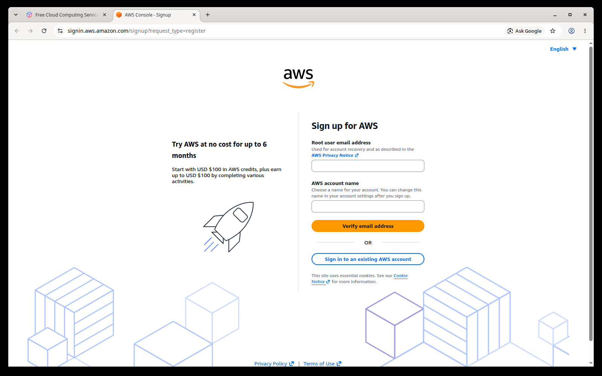
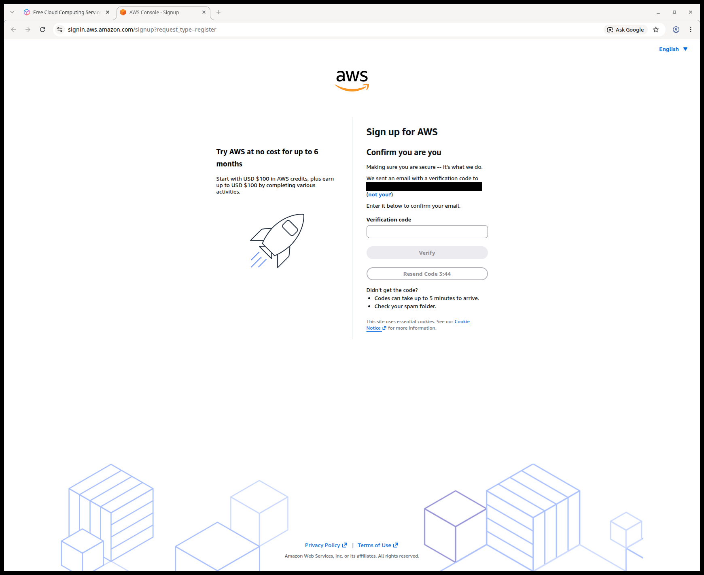
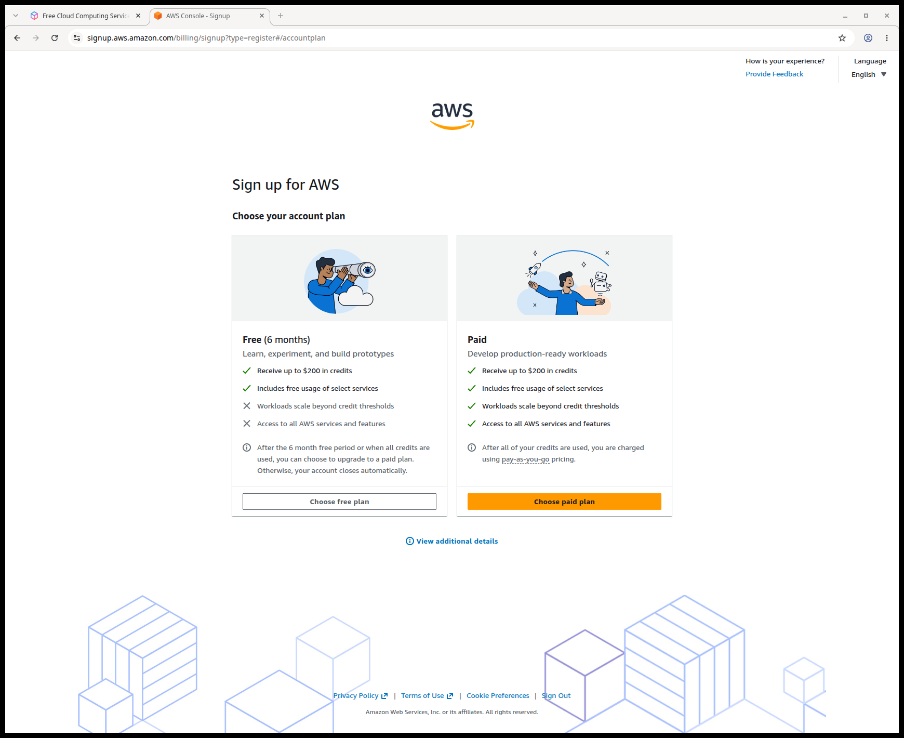
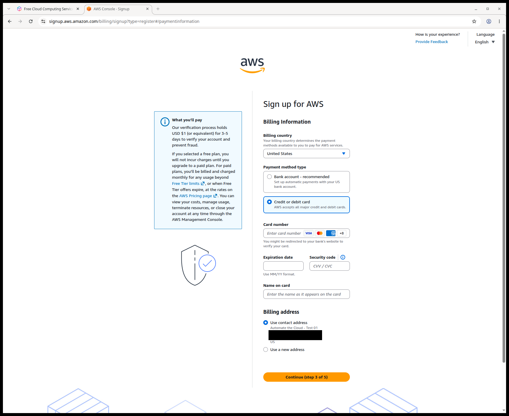

# Create your AWS account with the advanced sign-up and the Free plan

> **Your account, your responsibility.** Read the [notice](00-read-this-first.md#before-you-start-your-account-your-responsibility) before you follow any step.

**Goal:** a new AWS account on the Free plan, created through AWS's advanced sign-up, with a root user whose email, password and phone you control. At the end, you are signed in to the AWS Management Console (the website where you manage AWS) and have chosen the Region (the part of the world) where your labs will run.

**Time:** about 30 minutes. **Cost:** $0. AWS holds USD $1 on your card for 3 to 5 days to check it (as of 2026-10-23).

**Why this matters:** the **root user** is the sign-in you create during sign-up. It can do anything in the account, including closing it and changing billing. Whoever controls its email, password and phone controls the account.

## Before you start: gather four things

Get these ready before you open the sign-up page. Each one is a small guardrail.

### A dedicated email address

**Do:** use an email address that exists only for this AWS account, such as a new address or alias at a provider you trust. Keep that inbox secure, with its own strong password and multi-factor authentication (MFA), which asks for a second proof such as a code or a passkey when you sign in.

**Don't:** use your everyday email, or a work or school address you could lose. Once an account is closed, AWS won't let you use its email address for another AWS account.

**Why:** this address is the root user's sign-in name and the way AWS lets you reset the root password. Anyone who can read this inbox can take over the account. AWS also recommends not using the root user's email for anything else ([Root user best practices for your AWS account](https://docs.aws.amazon.com/IAM/latest/UserGuide/root-user-best-practices.html)).

**Cost:** $0. **Free plan:** no effect.

**Well-Architected:** Security · [SEC01-BP02 Secure account root user and properties](https://docs.aws.amazon.com/wellarchitected/latest/security-pillar/sec_securely_operate_aws_account.html)

### A password manager

**Do:** let a password manager generate a long, random root password and store it. AWS's minimum is 8 characters with at least three kinds of characters (such as uppercase, lowercase, numbers and symbols), and the password can't match the account name or email. We suggest at least 16 characters; a password manager makes length free.

**Don't:** reuse a password from anywhere else. If that other site ever leaks it, your AWS account is exposed too.

**Cost:** nothing from AWS. **Free plan:** no effect.

**Well-Architected:** Security · [SEC02-BP01 Use strong sign-in mechanisms](https://docs.aws.amazon.com/wellarchitected/latest/security-pillar/sec_identities_enforce_mechanisms.html)

### A phone number you will keep

**Do:** use a phone number that can receive texts and calls, and that you will still have in a year.

**Why:** AWS uses this number to confirm who you are. If you ever lose every MFA device for the root user, you need both this phone and the account's email to get back in.

**Cost:** $0. **Free plan:** no effect.

**Well-Architected:** Security · [SEC01-BP02 Secure account root user and properties](https://docs.aws.amazon.com/wellarchitected/latest/security-pillar/sec_securely_operate_aws_account.html)

### A payment card you watch

**Do:** have a credit or debit card ready, one whose statements you check. If your bank offers a virtual card or a card with a low limit, consider using it. That is our suggestion, not AWS's.

**Why:** on 2026-10-23 the advanced sign-up wouldn't continue without a payment method, although some AWS pages say most new customers don't need one. AWS doesn't charge the card on the Free plan unless you upgrade.

**Cost:** a USD $1 hold (or the equivalent in your currency) for 3 to 5 days, as of 2026-10-23. **Free plan:** no effect, as long as you don't upgrade.

**Well-Architected:** Cost optimization · no single best practice covers this; it loosely supports the design principle "[Implement Cloud Financial Management](https://docs.aws.amazon.com/wellarchitected/latest/framework/cost-dp.html)".

## Steps

The screens below are the ones we saw on 2026-10-23. AWS changes them often. If a label differs, look for the option with the same meaning.

### Open the advanced sign-up page

1. In your browser's address bar, enter this address: `https://signin.aws.amazon.com/signup?request_type=register`

   Don't start from the "Create a free account" buttons on AWS's Free Tier page. On 2026-10-23 they led to the newer sign-up experience, which this primer doesn't cover.

   **You should see:** a page titled **Sign up for AWS** with two boxes: **Root user email address** and **AWS account name**.

   

   *Screenshot: the advanced sign-up form, captured 2026-10-23 in our test account. AWS console screenshots are AWS material used as limited fair use and are not covered by this primer's license.*

   > **If something went wrong:** the page offers to sign you in with Google, GitHub or an AWS Builder ID instead → you are in the newer sign-up experience → check that the address ends in `request_type=register` and try again. If it still happens, stop and read [If you landed in the new sign-up experience](#if-you-landed-in-the-new-sign-up-experience).

2. In **Root user email address**, enter your dedicated email address.

3. In **AWS account name**, enter a plain name for the account, such as `study-lab`.

   **Don't:** put your full name, address or anything else personal in it. AWS advises against account names that identify a person. The account name is shown in the console's top bar, and the screen says you can change it later.

   **Cost:** $0. **Free plan:** no effect.

   **Well-Architected:** Security · no single best practice covers this; it is general privacy hygiene.

4. Choose **Verify email address**.

### Confirm your email

5. Open the dedicated inbox and find the email from AWS with a verification code.

   **You should see:** a page titled **Confirm you are you** with a **Verification code** box.

   > **If something went wrong:** no email arrives → check your spam or junk folder. On 2026-10-23 the page said: "Codes can take up to 5 minutes to arrive. Check your spam folder." Wait five minutes, then use **Resend Code**. Keep checking spam for every AWS email you expect from now on.

   

   *Screenshot: the email verification page, captured 2026-10-23 in our test account. AWS console screenshots are AWS material used as limited fair use and are not covered by this primer's license.*

6. Enter the code and choose **Verify**.

### Set the root user password

7. On **Create your password**, paste the password from your password manager into **Root user password** and **Confirm root user password**.

   **You should see:** a green message saying your email address has been verified.

8. Choose **Continue (step 1 of 5)**.

### Choose the Free plan

9. On **Choose your account plan**, read both cards. On 2026-10-23 they were labeled **Free (6 months)** and **Paid**. To see the full terms, choose **View additional details**, read them, then close the panel.

   **You should see:** the Free card says that after the 6-month free period, or when all credits are used, you can upgrade, and that otherwise the account closes automatically.

   

   *Screenshot: the account plan choice, captured 2026-10-23 in our test account. AWS console screenshots are AWS material used as limited fair use and are not covered by this primer's license.*

10. Choose **Choose free plan**.

    > **If something went wrong:** there is no Free plan option → AWS's FAQ says people who have had an AWS account before may not be eligible for the Free plan or credits. AWS doesn't say how it checks. Stop here. On the Paid plan, anything the credits don't cover is billed to your card. Read the [Free Tier FAQs](https://aws.amazon.com/free/free-tier-faqs/) before you decide whether to continue.

### Enter your contact information

11. On **Contact Information**, enter your full name, phone number and address. **Organization name** is optional; leave it empty for a personal account.

    AWS expects your real name here. This is different from the account name in step 3, which is a label shown in the console.

12. Read the AWS Customer Agreement through the link, then select the checkbox that says you agree to it.

13. Choose **Agree and Continue (step 2 of 5)**.

### Add a payment method

14. On **Billing Information**, check that **Billing country** is correct.

15. Under **Payment method type**, select **Credit or debit card**.

    On 2026-10-23 the preselected option for the United States was **Bank account - recommended**, which links your bank account. Choose the card option if you don't want to link a bank account.

    

    *Screenshot: the billing information step with the card option selected, captured 2026-10-23 in our test account. AWS console screenshots are AWS material used as limited fair use and are not covered by this primer's license.*

16. Enter the card details, and keep **Use contact address** selected unless the card's billing address is different.

17. Choose **Continue (step 3 of 5)**.

    **You should see:** possibly a page from your bank asking you to approve the card check. The screen warned on 2026-10-23 that this might happen.

    > **If something went wrong:** the **Continue** button stays gray → a payment method isn't complete yet → fill in every card field. The bank page fails → contact your bank, then try again.

### Land in the console

18. Wait while AWS sets up the account.

    **You should see:** a short "setting up your account" message, then the **Console Home** page. On 2026-10-23 the console opened directly after the card step. The "of 5" counter suggested two more steps, but they never appeared.

    > **If something went wrong:** the console doesn't open → AWS says activation usually takes a few minutes but can take up to 24 hours → watch the dedicated inbox (and its spam folder) for AWS's emails, then sign in at the console.

19. At the top right of the console, look at the **Region selector**. A **Region** is a geographic area where AWS runs its data centers. Most things you create live in one Region.

    **You should see:** on 2026-10-23 our new account opened in **United States (Ohio)**, which is `us-east-2`.

20. Open the Region selector and choose N. Virginia, which is `us-east-1` (AWS's documentation calls it US East (N. Virginia); on 2026-10-23 the selector used names like "United States (Ohio)"). Our guides use this Region unless a guide says otherwise. AWS keeps its billing alarms and billing data there, which you use on [page 05](05-money-alarms.md).

    **Don't:** create anything in a Region you don't use. Resources there are easy to forget, and they keep costing credits or money. Check the Region selector before every lab.

    **Cost:** $0. **Free plan:** no effect.

    **Well-Architected:** Cost optimization · [COST02-BP05 Implement cost controls](https://docs.aws.amazon.com/wellarchitected/latest/cost-optimization-pillar/cost_govern_usage_controls.html)

21. On Console Home, find the **Cost and usage** box. Write down the date shown next to **Days remaining**. That is when your Free plan ends.

    **You should see:** **Credits remaining** of $100.00 and a number of days with an end date. Cost figures may show "Data unavailable" on the first day (as of 2026-10-24). That is normal; cost data takes up to 24 hours to appear.

    Use the end date, not the day count. In our account the counter still showed the same number of days a day later.

## What didn't happen, and why that's fine

AWS's sign-up guide describes two more steps: a phone check by text or call, and a choice of Support plan. Neither appeared for us on 2026-10-23. If the phone check appears, follow it.

If a Support plan choice appears, choose **Basic**, which is free. **Don't** buy a paid Support plan for study. Basic Support is included with the Free plan and already lets you open account and billing cases at no charge. Paid plans add technical help that a lab account doesn't need.

**Cost:** $0. **Free plan:** Basic Support is included.

**Well-Architected:** Operational excellence · [OPS07-BP06 Create support plans for production workloads](https://docs.aws.amazon.com/wellarchitected/latest/operational-excellence-pillar/ops_ready_to_support_enable_support_plans.html) (by contrast: a lab account isn't production, so free Basic Support is enough)

## Your credits and the two clocks

On the Free plan, two dates matter (as of 2026-10-23):

- **The plan ends** about 6 months after sign-up, or sooner if you use up your credits. Console Home shows this date.
- **The credits expire** 12 months after sign-up. The **Credits** page in the Billing console shows each credit's expiration date.

On the Free plan the 6-month date always comes first, so watch that one. AWS's own pages disagree about these periods; this is what our new account showed.

## If you landed in the new sign-up experience

If you signed up through a "Create a free account" button and signed in with Google, GitHub or an AWS Builder ID, your account works differently from what this primer describes (as of 2026-10-23):

- There is no root user. An AWS Builder ID, tied to your login, owns the account, and you set up MFA in AWS Settings instead.
- IAM users can't sign in to the console, so [page 03](03-your-everyday-admin-identity.md) doesn't apply.
- AWS picks your Region from your contact country, and you can't change it.
- Some services, such as IAM Identity Center and Trusted Advisor, aren't supported.
- Its Paid plan offers **spend limits**, which pause your resources when spending reaches a limit you set. The advanced path has none.

Much of this primer won't match your screens. Before you create a second account to switch paths, read AWS's eligibility terms: the [AWS Free Tier Terms](https://aws.amazon.com/free/terms/) say Free Tier credits are for only one account.

## Check your work

You are done with this page when all of these are true:

- [ ] You are signed in to the console, and the top bar shows your plain account name.
- [ ] The Region selector shows N. Virginia (`us-east-1`).
- [ ] Console Home's **Cost and usage** box shows credits remaining and an end date, and you wrote the date down.
- [ ] The root password is saved in your password manager, under the dedicated email address.

## Recap

You created an AWS account through the advanced sign-up and kept it on the Free plan, so it can't bill you. Its root user uses an email, password and phone that only you control. You chose a lab Region and know where to see the plan's end date.

**One gap is still open.** On 2026-10-23, sign-up signed the root user in with only a password, and nothing asked for MFA. AWS requires MFA for the root user within 14 days of the first sign-in, but don't wait. Go straight to [page 02](02-secure-the-root-user.md), "Secure the root user", and do nothing else in the account first.

## Check yourself

**1. Why should the root user's email address be one you use only for this AWS account?**

Feedback

**Model answer:** The email address is the root user's sign-in name and the way to reset its password. Anyone who can read that inbox can take control of the account, so it should be a separate, well-protected inbox. A dedicated address also can't be lost with a job or school account, and AWS won't let you reuse a closed account's address anyway.

**2. Your new account opens with the Region selector showing United States (Ohio). Before your first lab, what do you do?**

A. Nothing. AWS chose the best Region for you.
B. Switch to US East (N. Virginia), unless your guide names another Region.
C. Turn on every Region so labs work everywhere.
D. Create a test resource in Ohio to check that the account works.

Feedback

**B is right.** Our guides use US East (N. Virginia), and AWS keeps billing data and billing alarms there. Working in one Region makes it easy to find and delete what you create.

- **A is wrong.** AWS didn't choose Ohio for your labs; it is simply where the console opened on 2026-10-23.
- **C is wrong.** More Regions mean more places to forget resources. Leave Regions you don't use alone.
- **D is wrong.** You don't need a test resource, and anything you create can cost credits. Build nothing until [page 05](05-money-alarms.md)'s money alarms are in place.

## Where to check the current details

- [Sign up for AWS (advanced)](https://docs.aws.amazon.com/accounts/latest/reference/getting-started.html), AWS Account Management Reference Guide (checked 2026-10-23)
- [Compare sign-up options](https://docs.aws.amazon.com/accounts/latest/reference/sign-up-for-aws.html), AWS Account Management Reference Guide (checked 2026-10-23)
- [Root user best practices for your AWS account](https://docs.aws.amazon.com/IAM/latest/UserGuide/root-user-best-practices.html), IAM User Guide (checked 2026-10-23)
- [Update your AWS account name](https://docs.aws.amazon.com/accounts/latest/reference/manage-acct-update-acct-name.html), AWS Account Management Reference Guide (checked 2026-10-23)
- [Choosing a plan](https://docs.aws.amazon.com/awsaccountbilling/latest/aboutv2/free-tier-plans.html), AWS Billing User Guide (checked 2026-10-23)
- [Free Tier FAQs](https://aws.amazon.com/free/free-tier-faqs/) (checked 2026-10-23)
- [Getting help with your bills and payments](https://docs.aws.amazon.com/awsaccountbilling/latest/aboutv2/billing-get-answers.html), AWS Billing User Guide (checked 2026-10-23)
- [Create and activate an AWS account](https://repost.aws/knowledge-center/create-and-activate-aws-account), AWS re:Post Knowledge Center (checked 2026-10-23)

---

"Create your AWS account with the advanced sign-up and the Free plan" by Automate the Cloud Inc., licensed under CC BY-NC 4.0 with the Additional Permission for Internal Training from Automate the Cloud Inc.
License: https://creativecommons.org/licenses/by-nc/4.0/
Permission: https://automatethe.cloud/licenses/atc-internal-training-permission.txt
