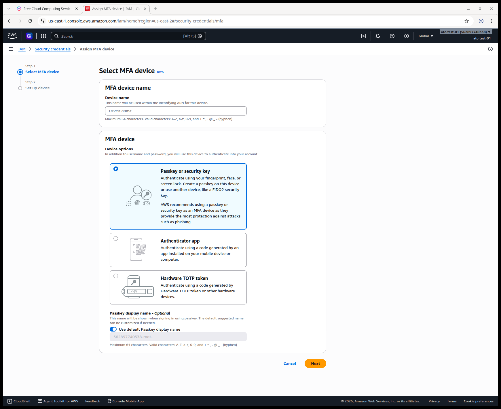
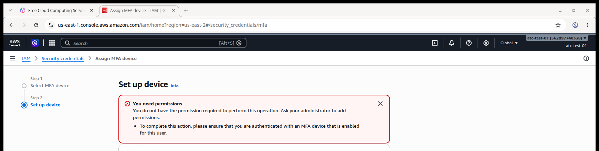
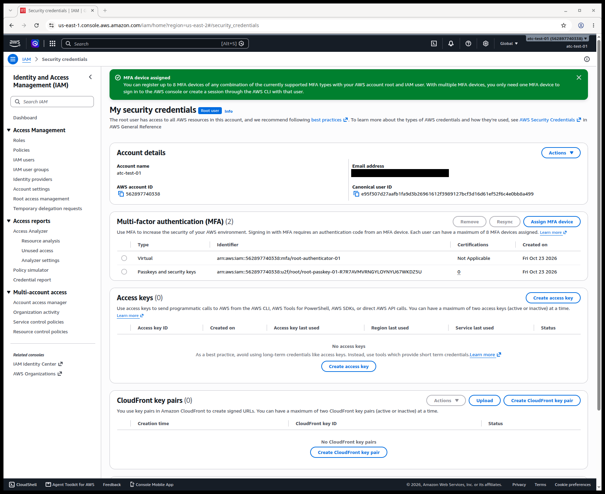
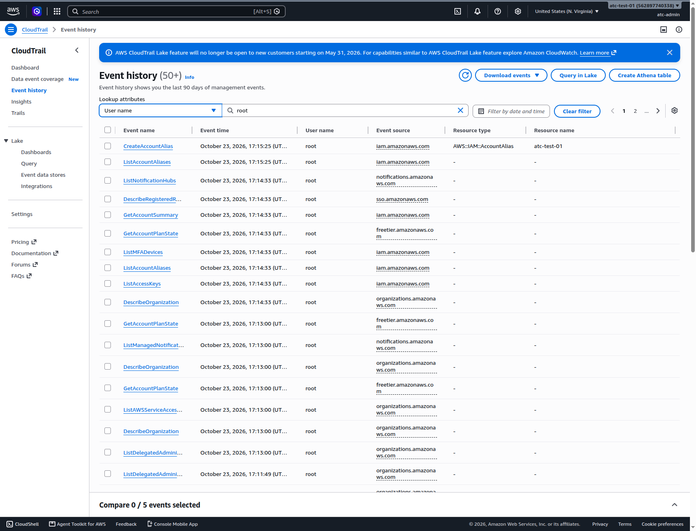

# Secure the root user, then stop using it

> **Your account, your responsibility.** Read the [notice](00-read-this-first.md#before-you-start-your-account-your-responsibility) before you follow any step.

The **root user** is the sign-in you created with your email address at sign-up. It can do everything in the account, and nothing can limit it. On this page you lock it down, then you use it only for the rare tasks that need it.

## Goal and end state

When you finish, your account has:

- a passkey and a backup authenticator app protecting the root user;
- no root access keys;
- correct contact details, plus billing, operations and security contacts;
- billing pages open to the admin identity you create on [page 03](03-your-everyday-admin-identity.md);
- a known place to see what the root user did.

AWS changes its screens often. The labels below are the ones we saw in our own test account on 2026-10-23.

## Before you start

- **An AWS account.** If you don't have one yet, follow [page 01](01-create-your-account.md) first.
- **Your root email address and password**, saved in a password manager.
- **A place to keep a passkey.** A **passkey** is a sign-in credential that lives on your device or in your password manager and that you unlock with your fingerprint, face or device PIN. A password manager that supports passkeys, your phone, your computer, or a hardware security key all work.
- **An authenticator app** on your phone, for the backup device. An **authenticator app** shows a six-digit code that keeps changing.
- **About 25 minutes.** Everything on this page costs $0 (as of 2026-10-23) and doesn't change your Free plan. A hardware security key, if you choose to buy one, is your own cost.

> **If you signed up through AWS's new sign-up experience:** that path has no root user. You register MFA in AWS Settings instead, and alternate contacts don't apply. This page is written for the advanced sign-up path.

## Add a passkey to the root user

**Multi-factor authentication (MFA)** means that signing in needs a second thing besides your password: here, a passkey. AWS recommends a passkey or security key over other kinds of MFA because they resist **phishing**, the trick of luring you to a fake sign-in page. A six-digit code can be typed into a fake page or read out to a scammer. AWS requires root MFA within 14 days of the first sign-in attempt, but our test account wasn't forced to set it up at sign-up. Do it now.

1. Go to the AWS sign-in page. It opens on **IAM user sign in**. Choose **Sign in using root user email**.
2. On the **Sign In** page, select **Root user**, type your root email address, and choose **Next**. Then enter your root password when asked.
   **You should see:** the AWS console home page.
3. In the top-right corner, open the menu that shows your account name, and choose the security credentials option.
   **You should see:** **My security credentials** with a **Root user** label, and a warning that says "You don't have MFA assigned".
4. Choose **Assign MFA device**.
5. In **Device name**, type a name with no spaces, such as `root-passkey-01`.
6. Under **Device options**, select **Passkey or security key**.

   

   *Screenshot: the MFA device choice for the root user, captured 2026-10-23 in our test account. AWS console screenshots are AWS material used as limited fair use and are not covered by this primer's license.*

7. Look at **Passkey display name**. The suggested name includes your 12-digit account ID. Keep it, or turn off the default and type your own name without spaces. Choose **Next**.
   > **If something went wrong:** a name is rejected → it contains a space or another character AWS doesn't allow. On 2026-10-23 the screen allowed only letters, digits and `+ = , . @ _ -`. Remove the space and try again.
8. Follow your browser's prompts to save the passkey in your password manager or device, or touch your security key.
   **You should see:** a green banner, "Passkey MFA device assigned", and **Multi-factor authentication (MFA) (1)**.

## Sign out and back in before you add a backup device

Add a second MFA device as a backup, so that losing one device doesn't lock you out. Without any device, recovering the root user needs both your account email and your phone number. You can register up to eight devices.

**Sign out first.** AWS lets you add another MFA device only from a session that was signed in with MFA. Your current session started before the passkey existed, so it doesn't count.

9. Open the menu in the top-right corner and choose the option to sign out.
10. Sign in as the root user again, as in steps 1 and 2. When asked, use your new passkey.
    **You should see:** the console home page.
11. Go back to **My security credentials**, as in step 3, and choose **Assign MFA device**.
12. Type a device name such as `root-authenticator-01`, select **Authenticator app**, and choose **Next**.
13. Scan the QR code with your authenticator app, and type the codes the screen asks for.
    **Don't** photograph, screenshot or share the QR code. It contains the secret that generates your codes. Turn on your authenticator app's cloud backup or sync, if it has one.
    **You should see:** "MFA device assigned", and **Multi-factor authentication (MFA) (2)** listing a **Virtual** device and a **Passkeys and security keys** device.
    > **If something went wrong:** you see "You need permissions" and a line asking you to make sure you are authenticated with an MFA device that is enabled for this user (as of 2026-10-23) → your session didn't start with MFA. Sign out, sign back in with the passkey, and repeat steps 11 to 13.

    

    *Screenshot: the error we got when adding a second MFA device before signing in with the first, captured 2026-10-23 in our test account. AWS console screenshots are AWS material used as limited fair use and are not covered by this primer's license.*

**What it costs:** $0 (as of 2026-10-23). **Free plan:** no change.

**Well-Architected:** Security · [SEC01-BP02 Secure account root user and properties](https://docs.aws.amazon.com/wellarchitected/latest/security-pillar/sec_securely_operate_aws_account.html); Security · [SEC02-BP01 Use strong sign-in mechanisms](https://docs.aws.amazon.com/wellarchitected/latest/security-pillar/sec_identities_enforce_mechanisms.html)

## Confirm the root user has no access keys

An **access key** is a pair of secret strings that lets a program act as a user, without a password or MFA. A root access key would give anyone who finds it full control of your account, including billing, and it doesn't expire on its own. AWS strongly recommends never creating one. When you need the command line, [page 04](04-command-line-without-access-keys.md) shows ways that need no keys.

14. On **My security credentials**, scroll to **Access keys**.
    **You should see:** **Access keys (0)** and "No access keys".
    **Don't** choose **Create access key**, even "just for the command line".
    > **If something went wrong:** a key is listed → if you created it, deactivate it and then delete it. If you didn't create it, someone else may have your root password; follow [page 08](08-when-something-goes-wrong.md) now.

*Screenshot: the root user with two MFA devices and no access keys, captured 2026-10-23 in our test account. AWS console screenshots are AWS material used as limited fair use and are not covered by this primer's license.*

**What it costs:** $0. **Free plan:** no change.

**Well-Architected:** Security · [SEC02-BP02 Use temporary credentials](https://docs.aws.amazon.com/wellarchitected/latest/security-pillar/sec_identities_unique.html); Security · [SEC01-BP02 Secure account root user and properties](https://docs.aws.amazon.com/wellarchitected/latest/security-pillar/sec_securely_operate_aws_account.html)

## Make sure AWS can reach you

AWS sends billing, security and abuse notices to your account's contacts. **Alternate contacts** are extra people (here, extra addresses) for billing, operations and security messages. For a personal lab account, point all three at an email address you read. In a company, AWS suggests a shared mailbox or mailing list rather than one person's address.

15. Open the menu in the top-right corner and choose the account option.
    **You should see:** **Billing and Cost Management > Account**.
    **Don't** choose the banner's offer to try the new account page. On 2026-10-23 it said the new page "now lives with AWS Organizations". We haven't checked what it does on a Free plan account. Joining AWS Organizations upgrades the plan (see [page 00](00-read-this-first.md)).
16. In **Contact information**, check your name, address and phone number. If anything is wrong, choose **Edit** and fix it. Keep a phone number you will still have next year: it is part of root recovery.
17. In **Alternate contacts**, under **Billing contact**, choose the button to add or edit the contact. Fill in **Full name**, **Title**, **Email address** and **Phone number**, and save.
    **You should see:** "Successfully added billing contact."
18. Repeat step 17 for **Operations contact** and **Security contact**.

**What it costs:** $0. **Free plan:** no change.

**Well-Architected:** Security · [SEC10-BP01 Identify key personnel and external resources](https://docs.aws.amazon.com/wellarchitected/latest/security-pillar/sec_incident_response_identify_personnel.html)

## Let your admin user see billing

By default, IAM users can't open the billing pages, even with full administrator permissions. (**IAM** is the AWS service that controls who can do what in your account; [page 03](03-your-everyday-admin-identity.md) creates your IAM user.) Only the root user can change this. Without it, you can't create the budgets on [page 05](05-money-alarms.md) from your everyday sign-in.

19. On the same **Account** page, scroll to **IAM user and role access to Billing information**, and choose **Edit**.
20. Select **Activate IAM Access**, and choose **Update**.
    **You should see:** "Your IAM Access setting was updated successfully." and the status **Activated**.

**What it costs:** $0. **Free plan:** no change.

**Well-Architected:** Cost optimization · [COST03-BP05 Configure billing and cost management tools](https://docs.aws.amazon.com/wellarchitected/latest/cost-optimization-pillar/cost_monitor_usage_config_tools.html)

## Know where root activity shows up

If someone else ever signs in as your root user, you want to be able to see it. **AWS CloudTrail** records actions taken in your account. Its **Event history** keeps the last 90 days of actions that view or change your account's settings and resources, free, with nothing to set up. It shows one Region at a time. The IAM **credential report** lists every user, including the root user, with the time each password was last used.

21. Search for **CloudTrail** in the console search box, open it, and choose **Event history**.
22. In the console's Region selector, at the top right, choose N. Virginia, `us-east-1` (shown as **United States (N. Virginia)** on 2026-10-23). Our guides use this Region.
23. Under **Lookup attributes**, choose **User name**, and type `root`.
    **You should see:** the actions you took on this page, each with user name **root**.

    

    *Screenshot: Event history filtered to the root user, captured 2026-10-23 in our test account. AWS console screenshots are AWS material used as limited fair use and are not covered by this primer's license.*

24. Open IAM (search for **IAM**) and choose **Credential report** in the left menu. Choose the option to download the report.
    **You should see:** a CSV file, which opens in any spreadsheet program. In the root user's row, the `password_last_used` column shows your last root sign-in. AWS makes a new report at most once every four hours, so a very recent sign-in may not appear yet.

Professionals also set up automatic alerts for every root sign-in. For a lab account, checking Event history after a surprise is enough.

**What it costs:** $0. Viewing Event history is free. **Free plan:** no change.

**Well-Architected:** Security · [SEC04-BP01 Configure service and application logging](https://docs.aws.amazon.com/wellarchitected/latest/security-pillar/sec_detect_investigate_events_app_service_logging.html)

> **Bad practice: daily work as root.** Signing in as root for everyday work is the most common beginner mistake. Every action you take as root runs with no limits. One wrong click, or one stolen session, can touch anything in the account, including billing and the account itself. The Well-Architected security pillar names this as an anti-pattern. Only a few account-level tasks need root, and you've just done the ones a lab account needs now. From [page 03](03-your-everyday-admin-identity.md) on, you work as an IAM user and leave root signed out.

## Check your work

1. Open IAM and choose **Dashboard**.
   **You should see:** under **Security recommendations**, green checks for "Root user has MFA" and "Root user has no active access keys".
2. **My security credentials** shows **MFA (2)** and **Access keys (0)**.
3. The **Account** page shows three alternate contacts, and billing access for IAM users is **Activated**.

## Recap

The root user now needs your password plus one of two MFA devices, and it has no keys. AWS can reach you about billing and security. Your future admin user will be able to see billing. You know where to look if you suspect someone used root. Next, on [page 03](03-your-everyday-admin-identity.md), you create the IAM user you will sign in with every day.

## Check yourself

**1. You've just registered a passkey on the root user. You try to add an authenticator app straight away and get a "You need permissions" error. What should you do?**

A. Ask AWS Support to grant the permission.
B. Sign out, sign back in with the passkey, then add the authenticator app.
C. Remove the passkey and register the authenticator app first.
D. Create a root access key and add the device from the command line.

Feedback

**B is right.** AWS lets you add another MFA device only from a session that started with MFA. Your session began before the passkey existed.

- **A is wrong.** Nothing is missing from your permissions; the root user can do everything. The session just needs MFA.
- **C is wrong.** It removes your stronger device and brings you back to the same problem with the next device.
- **D is wrong.** Root access keys are exactly what you must never create, and they don't solve the problem.

**2. Why does this page recommend a passkey rather than an authenticator app as your main MFA device?**

Feedback

**Model answer:** A passkey resists phishing. A six-digit code can be typed into a fake sign-in page or given to a scammer, and the attacker can use it straight away. AWS itself recommends passkeys and security keys for this reason. The authenticator app is still useful as a backup, in case you lose the passkey.

**3. You suspect someone signed in as your root user last week. Name two places to check, and one limit of each.**

Feedback

**Model answer:** CloudTrail Event history, filtered by user name `root`: it covers only the last 90 days and one Region at a time. The IAM credential report, `password_last_used` for the root user: it shows only the most recent password use, and it's regenerated at most every four hours.

## Where to check the current details

- [Root user best practices for your AWS account](https://docs.aws.amazon.com/IAM/latest/UserGuide/root-user-best-practices.html), IAM User Guide (checked 2026-10-23)
- [Multi-factor authentication for AWS account root user](https://docs.aws.amazon.com/IAM/latest/UserGuide/enable-mfa-for-root.html), IAM User Guide (checked 2026-10-23)
- [Assign a passkey or security key in the AWS Management Console](https://docs.aws.amazon.com/IAM/latest/UserGuide/id_credentials_mfa_enable_fido.html), IAM User Guide (checked 2026-10-23)
- [Assign a virtual MFA device in the AWS Management Console](https://docs.aws.amazon.com/IAM/latest/UserGuide/id_credentials_mfa_enable_virtual.html), IAM User Guide (checked 2026-10-23)
- [Create access keys for the root user](https://docs.aws.amazon.com/IAM/latest/UserGuide/id_root-user_manage_add-key.html), IAM User Guide (checked 2026-10-23)
- [Update the alternate contacts for your AWS account](https://docs.aws.amazon.com/accounts/latest/reference/manage-acct-update-contact-alternate.html), AWS Account Management Reference Guide (checked 2026-10-23)
- [Overview of managing access permissions](https://docs.aws.amazon.com/awsaccountbilling/latest/aboutv2/control-access-billing.html), AWS Billing User Guide (checked 2026-10-23)
- [Working with CloudTrail event history](https://docs.aws.amazon.com/awscloudtrail/latest/userguide/view-cloudtrail-events.html), AWS CloudTrail User Guide (checked 2026-10-23)
- [Generate credential reports for your AWS account](https://docs.aws.amazon.com/IAM/latest/UserGuide/id_credentials_getting-report.html), IAM User Guide (checked 2026-10-23)
- [Manage multi-factor authentication (MFA) in AWS Settings](https://docs.aws.amazon.com/accounts/latest/reference/register-mfa-devices.html), for the new sign-up experience (checked 2026-10-23)
- [Security Pillar](https://docs.aws.amazon.com/pdfs/wellarchitected/latest/security-pillar/wellarchitected-security-pillar.pdf), AWS Well-Architected Framework (checked 2026-10-23)

---

"Secure the root user, then stop using it" by Automate the Cloud Inc., licensed under CC BY-NC 4.0 with the Additional Permission for Internal Training from Automate the Cloud Inc.
License: https://creativecommons.org/licenses/by-nc/4.0/
Permission: https://automatethe.cloud/licenses/atc-internal-training-permission.txt
