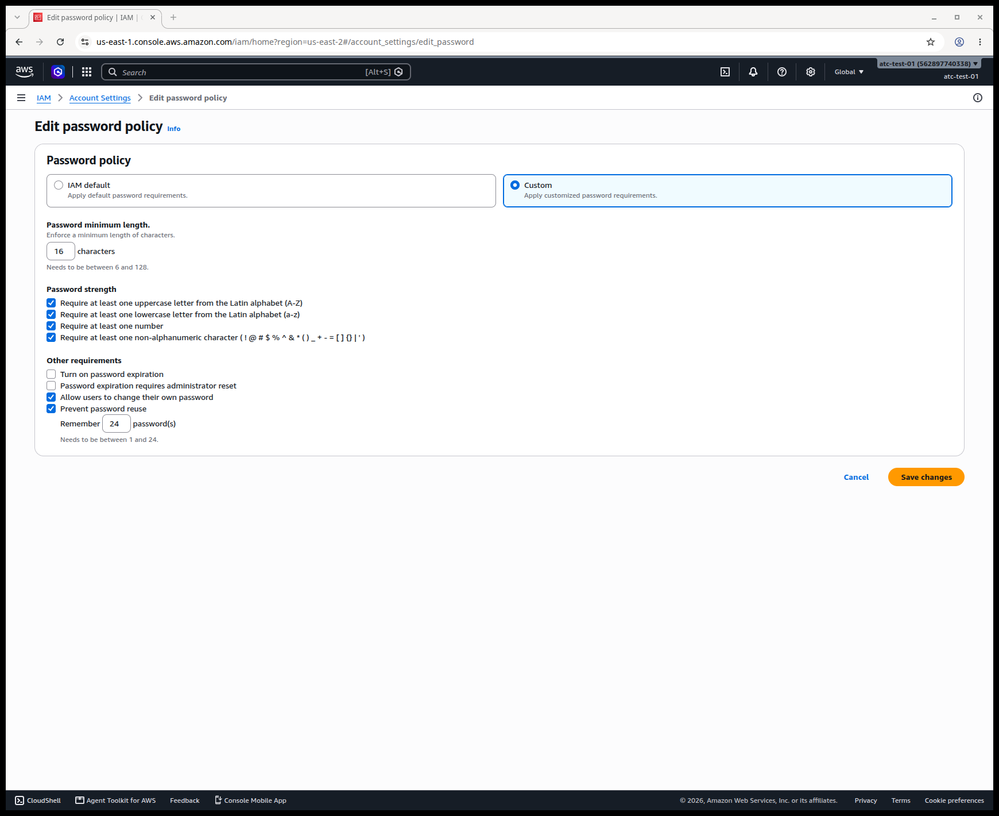
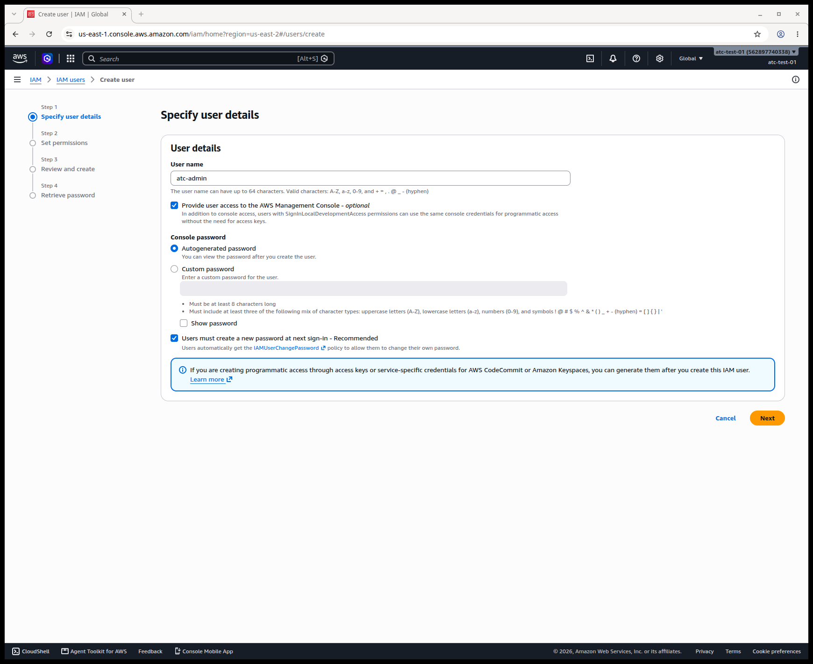
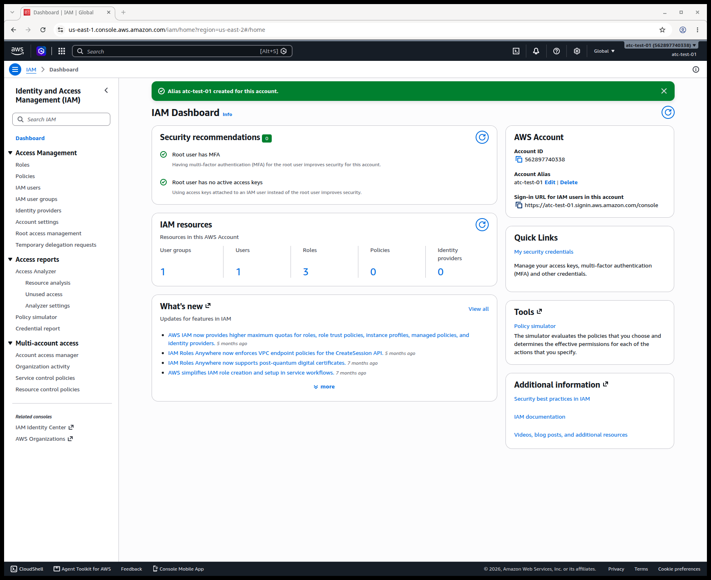
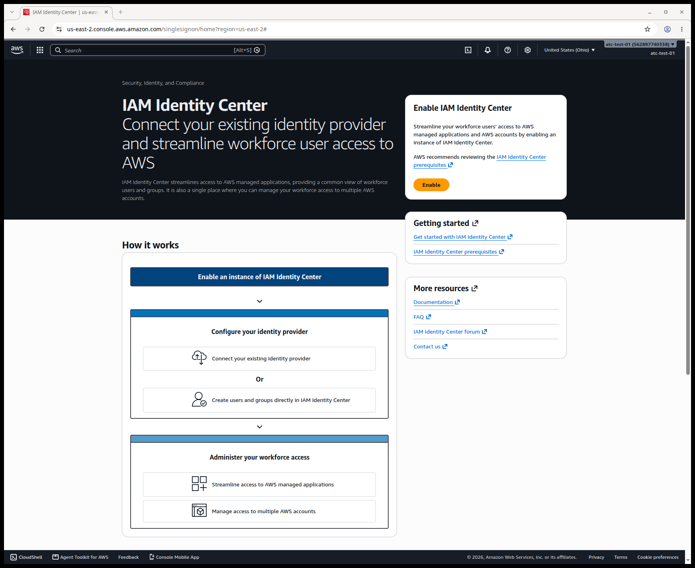

# Do your daily work as an IAM user with MFA

> **Your account, your responsibility.** Read the [notice](00-read-this-first.md#before-you-start-your-account-your-responsibility) before you follow any step.

From now on, you sign in to AWS as an IAM user, not as the root user. On this page you set a strong password rule, create an administrator group and a user in it, sign in as that user, and protect it with the same two MFA devices you gave the root user.

**IAM** (AWS Identity and Access Management) is the AWS service that controls who can sign in to your account and what they can do there. An **IAM user** is a named identity inside your account, with its own password and MFA devices. Unlike the root user, its permissions can be limited.

## Goal and end state

When you finish, your account has:

- a password policy that meets the [CIS AWS Foundations Benchmark](https://www.cisecurity.org/benchmark/amazon_web_services)'s settings for length and reuse;
- a group called `Admins` with full administrator permissions;
- one IAM user for you, in that group, with a passkey and a backup authenticator app;
- the sign-in address for that user saved in your password manager.

You also know why we don't use IAM Identity Center on the Free plan.

AWS changes its screens often. The labels below are the ones we saw in our own test account on 2026-10-23.

## Before you start

- **[Page 02](02-secure-the-root-user.md) finished.** The root user has MFA, and IAM users can see billing. If not, do [page 02](02-secure-the-root-user.md) first.
- **Signed in as the root user**, with MFA. Root is needed one last time, to create the first IAM user.
- **Your password manager**, to create and store a new password.
- **A passkey location and an authenticator app**, as on [page 02](02-secure-the-root-user.md).
- **About 20 minutes.** IAM has no charge (as of 2026-10-23). In our Free plan test account, nothing on this page changed the plan.

> **If you signed up through AWS's new sign-up experience:** IAM users there can't sign in to the console, so this page doesn't apply as written.

## Set a stronger password policy

A **password policy** is the account's rule for IAM user passwords. AWS's default asks for only 8 characters and three kinds of character. The **CIS AWS Foundations Benchmark**, a published checklist of security settings for AWS accounts from the Center for Internet Security, asks for more. In version 5.0.0, controls 1.7 and 1.8 ask for a minimum length of at least 14 characters and for the last 24 passwords to be blocked from reuse. Set the policy before you create your user, so that your user's password must meet it.

The policy doesn't cover the root user's password or access keys. AWS also has no setting that locks a user out after wrong guesses; it recommends strong passwords plus MFA instead.

1. In the console search box, type **IAM** and open it. In the left menu, choose **Account settings**.
   **You should see:** **Password policy**, showing the default: 8 characters minimum, three of four character types.
2. Choose **Edit**, then select **Custom**.
3. Set **Password minimum length** to `16`. Anything from 14 meets the benchmark; we used 16.
4. Under **Password strength**, select all four boxes: uppercase, lowercase, number, and non-alphanumeric character.
5. Under **Other requirements**, leave **Turn on password expiration** cleared, keep **Allow users to change their own password** selected, and select **Prevent password reuse**. Set **Remember** to `24`.

   

   *Screenshot: the custom password policy we set, captured 2026-10-23 in our test account. AWS console screenshots are AWS material used as limited fair use and are not covered by this primer's license.*

6. Choose **Save changes**.
   **You should see:** a box titled "Set custom password policy?" that says the policy affects new users and existing users when they change their passwords (as of 2026-10-23). Passwords that already exist aren't checked again until they're changed.
7. Choose **Set custom**.
   **You should see:** the new policy on the **Account settings** page.

On the same page you'll see **Role manager**, set to **Disabled**. Leave it off. AWS's own text on that page warns that the roles it creates "are often highly permissive" (as of 2026-10-23).

**What it costs:** $0. **Free plan:** no change.

**Well-Architected:** Security · [SEC02-BP01 Use strong sign-in mechanisms](https://docs.aws.amazon.com/wellarchitected/latest/security-pillar/sec_identities_enforce_mechanisms.html)

## Create an Admins group

A **user group** is a set of IAM users who share the same permissions. A **policy** is a document that lists permissions. You attach the policy to the group, then put users in the group. This is easier to manage and audit than giving each user permissions one by one, and the console itself recommends it.

8. In IAM's left menu, choose **IAM user groups**, then choose the button to create a group.
9. In **User group name**, type `Admins`.
10. Under **Attach permissions policies**, search for `AdministratorAccess`, and select the policy with exactly that name. Its type is **AWS managed - job function**.
    **Don't** pick a similar name, such as one ending in `-Amplify`.
11. Choose the button to create the group.
    **You should see:** `Admins` in the list of groups, with **AdministratorAccess** attached.

`AdministratorAccess` is full administrator access. That is right for the one person who owns a lab account. In a team, you would grant each person only the permissions their work needs, which is the principle of **least privilege**. Later guides return to it.

**What it costs:** $0. **Free plan:** no change.

**Well-Architected:** Security · [SEC02-BP06 Employ user groups and attributes](https://docs.aws.amazon.com/wellarchitected/latest/security-pillar/sec_identities_groups_attributes.html); Security · [SEC03-BP02 Grant least privilege access](https://docs.aws.amazon.com/wellarchitected/latest/security-pillar/sec_permissions_least_privileges.html)

## Create your IAM user

12. In IAM's left menu, choose **IAM users**, then choose the button to create a user.
13. In **User name**, type a name you'll recognize, such as `lab-admin`.
14. Select **Provide user access to the AWS Management Console**.
15. Under **Console password**, select **Custom password**. Paste a new password from your password manager: at least 16 characters, with all four character types, used nowhere else.
16. Clear **Users must create a new password at next sign-in**. That option is for when you set a temporary password for someone else. You made this password yourself and have already stored it.

    

    *Screenshot: the console access options with AWS's defaults, before our changes, captured 2026-10-23 in our test account. AWS console screenshots are AWS material used as limited fair use and are not covered by this primer's license.*

17. Choose **Next**. Under **Permissions options**, keep **Add user to group** selected, and select the `Admins` group. Choose **Next**.
18. Check the summary, and choose the button to create the user.
    **You should see:** "User created successfully" and a **Retrieve password** page with a **Console sign-in URL**.
    > **If something went wrong:** the password is rejected → it doesn't meet the policy you set. Generate a longer one with all four character types.
19. Copy the **Console sign-in URL** into your password manager, in the same entry as the user name and password. The URL has the form `https://<your 12-digit account ID>.signin.aws.amazon.com/console`.
    **Don't** download the .csv file. Your password is already in your password manager, and a file holding a password is one more thing to leak.

**What it costs:** $0. **Free plan:** no change.

**Well-Architected:** Security · [SEC02-BP01 Use strong sign-in mechanisms](https://docs.aws.amazon.com/wellarchitected/latest/security-pillar/sec_identities_enforce_mechanisms.html)

## Optional: give the account a friendly alias

An **account alias** is a name you choose to use in place of your 12-digit account ID when IAM users sign in. It's a convenience, not a security setting: it protects nothing. Don't put personal information in it.

20. In IAM's left menu, choose **Dashboard**. In the **AWS Account** panel, next to **Account Alias**, choose **Create**. Type your alias and save it.
    **You should see:** "Alias … created for this account." The **Sign-in URL for IAM users in this account** now starts with your alias. Update the URL in your password manager.

*Screenshot: the IAM Dashboard after creating an alias, captured 2026-10-23 in our test account. AWS console screenshots are AWS material used as limited fair use and are not covered by this primer's license.*

No Well-Architected tag: this step is for convenience only.

## Sign in as your IAM user

21. Open the menu in the top-right corner and choose the option to sign out of the root user.
22. Open the sign-in URL you saved.
    **You should see:** **IAM user sign in**, with **Account ID or alias** already filled in.
23. Type your IAM user name and password, and choose **Sign in**.
    **You should see:** the console home page, with your IAM user name in the top-right corner.
    > **If something went wrong:** the page asks for an email address → you're on the root sign-in. Go back and use the IAM user sign-in. **Account ID or alias** is empty → type your account ID or alias.

## Protect your IAM user with a passkey and a backup

Your IAM user has full administrator access, so it needs the same protection as the root user. Use the same order as on [page 02](02-secure-the-root-user.md): one device, sign out and back in, then the backup.

24. Open the menu in the top-right corner and choose the security credentials option.
    **You should see:** **My security credentials** for your IAM user, with no **Root user** label.
25. Choose **Assign MFA device**. Type a device name with no spaces, such as `lab-admin-passkey-01`, select **Passkey or security key**, and choose **Next**. Follow your browser's prompts.
    **You should see:** "Passkey MFA device assigned".
26. Sign out, then sign in again from your saved URL, using the passkey when asked.
27. Back on **My security credentials**, choose **Assign MFA device**, type a name such as `lab-admin-authenticator-01`, select **Authenticator app**, and complete the setup. Don't capture or share the QR code.
    **You should see:** **Multi-factor authentication (MFA) (2)**.
    > **If something went wrong:** "You need permissions" → your session didn't start with MFA. Sign out, sign in with the passkey, and try again.

**What it costs:** $0. **Free plan:** no change.

**Well-Architected:** Security · [SEC02-BP01 Use strong sign-in mechanisms](https://docs.aws.amazon.com/wellarchitected/latest/security-pillar/sec_identities_enforce_mechanisms.html)

## Why we don't use IAM Identity Center on the Free plan

**IAM Identity Center** is AWS's service for managing people's sign-in and access to one or many AWS accounts from one central place. For people, AWS recommends it over IAM users, and the Well-Architected Framework has a best practice for it. So why doesn't this primer use it?

Identity Center comes in two kinds. The kind that gives people console access to accounts creates an **organization** in AWS Organizations, AWS's service for managing several accounts together, with your account as its management account. On the Free plan, creating an organization moves the account to the Paid plan automatically, and AWS's terms say you can then no longer use or earn Free Tier credits (as of 2026-10-23). The other kind avoids Organizations, but it has no sign-in portal for your accounts, so it can't give you console access.

When we opened the Identity Center page in our Free plan test account on 2026-10-23, it said nothing about Organizations, upgrades or credits. It showed only an **Enable** button. **Don't** choose **Enable** on a Free plan account.

*Screenshot: the IAM Identity Center welcome page on a Free plan account, captured 2026-10-23 in our test account. AWS console screenshots are AWS material used as limited fair use and are not covered by this primer's license.*

An IAM user with a strong password and MFA is a sound starting point for a single account. AWS's Startup Security Baseline gives it as the baseline for each person. On the Paid plan there's no Free plan to lose, but this primer still uses an IAM user, so that every learner has the same setup.

**Well-Architected:** Security · [SEC02-BP04 Rely on a centralized identity provider](https://docs.aws.amazon.com/wellarchitected/latest/security-pillar/sec_identities_identity_provider.html). This primer departs from that best practice on purpose, for the reasons above; later guides that use AWS Organizations come back to it.

## Check your work

1. Signed in as your IAM user, open IAM and choose **Dashboard**.
   **You should see:** green checks for "Root user has MFA" and "Root user has no active access keys" (as of 2026-10-23), and **User groups 1**, **Users 1**. You may also see **Roles 3**. AWS created those roles itself (they're called service-linked roles); you did nothing wrong.
2. **My security credentials** for your IAM user shows **MFA (2)** and **Access keys (0)**.
3. **Account settings** shows your custom password policy: 16 characters minimum, reuse of 24 passwords prevented.
4. Your password manager holds the IAM user's name, password and sign-in URL, separate from the root user's entry.

## Recap

You now have a daily sign-in that is an administrator, protected by a passkey and a backup, under a password policy that meets the CIS benchmark for length and reuse. The root user stays signed out, kept for the few tasks that need it. Identity Center is AWS's recommended way to give people access, but on the Free plan it would move you to the Paid plan. From here on, every page and every lab assumes you're signed in as this IAM user. Next, [page 04](04-command-line-without-access-keys.md) shows how to use the command line without creating access keys.

## Check yourself

**1. You're setting up your own IAM user. Why do you clear "Users must create a new password at next sign-in"?**

A. Because the password policy doesn't apply to new users.
B. Because the forced change is meant for a temporary password set by someone else, and you set yours yourself.
C. Because forced password changes turn off MFA.
D. Because the root user would have to approve the change.

Feedback

**B is right.** An administrator who creates a user for someone else forces a change so that only the user knows the final password. You chose this password and stored it, so a forced change adds nothing.

- **A is wrong.** The policy does apply to new users; the confirmation box said so.
- **C is wrong.** A password change has no effect on MFA devices.
- **D is wrong.** Root plays no part in an IAM user's password change.

**2. A friend on the Free plan says: "AWS recommends IAM Identity Center, so I'll just click Enable." What do you tell them?**

Feedback

**Model answer:** In a single account, the kind of Identity Center that gives console access creates an organization in AWS Organizations. On the Free plan, that moves the account to the Paid plan automatically, and the Free Tier credits can no longer be used. The Identity Center page gave no warning when we checked on 2026-10-23. Use an IAM user with MFA in an admin group instead.

**3. Which of these settings makes your account more secure: the password policy, the account alias, or both? Explain.**

Feedback

**Model answer:** Only the password policy. It forces long, varied passwords and blocks reuse of the last 24. The alias only replaces the 12-digit account ID in the sign-in address with a name you choose. It's a convenience and protects nothing.

## Where to check the current details

- [Set an account password policy for IAM users](https://docs.aws.amazon.com/IAM/latest/UserGuide/id_credentials_passwords_account-policy.html), IAM User Guide (checked 2026-10-23)
- [Create an IAM user in your AWS account](https://docs.aws.amazon.com/IAM/latest/UserGuide/id_users_create.html), IAM User Guide (checked 2026-10-23)
- [Security best practices in IAM](https://docs.aws.amazon.com/IAM/latest/UserGuide/best-practices.html), IAM User Guide (checked 2026-10-23)
- [Assign a passkey or security key in the AWS Management Console](https://docs.aws.amazon.com/IAM/latest/UserGuide/id_credentials_mfa_enable_fido.html), IAM User Guide (checked 2026-10-23)
- [ACCT.03 Configure console access for each user](https://docs.aws.amazon.com/prescriptive-guidance/latest/aws-startup-security-baseline/acct-03.html), AWS Startup Security Baseline (checked 2026-10-23)
- [Organization and account instances of IAM Identity Center](https://docs.aws.amazon.com/singlesignon/latest/userguide/identity-center-instances.html), IAM Identity Center User Guide (checked 2026-10-23)
- [Enable IAM Identity Center](https://docs.aws.amazon.com/singlesignon/latest/userguide/enable-identity-center.html), IAM Identity Center User Guide (checked 2026-10-23)
- [Choosing a plan](https://docs.aws.amazon.com/awsaccountbilling/latest/aboutv2/free-tier-plans.html), AWS Billing User Guide (checked 2026-10-23)
- [Security Pillar](https://docs.aws.amazon.com/pdfs/wellarchitected/latest/security-pillar/wellarchitected-security-pillar.pdf), AWS Well-Architected Framework (checked 2026-10-23)

---

"Do your daily work as an IAM user with MFA" by Automate the Cloud Inc., licensed under CC BY-NC 4.0 with the Additional Permission for Internal Training from Automate the Cloud Inc.
License: https://creativecommons.org/licenses/by-nc/4.0/
Permission: https://automatethe.cloud/licenses/atc-internal-training-permission.txt
