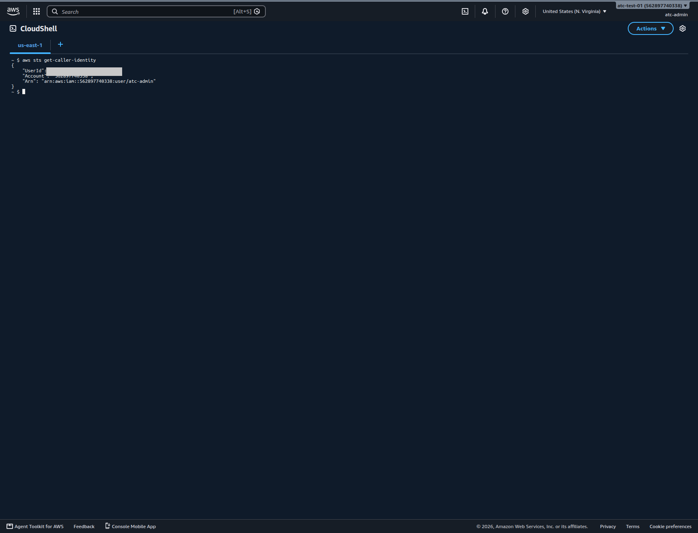

# Use the command line without creating access keys

> **Your account, your responsibility.** Read the [notice](00-read-this-first.md#before-you-start-your-account-your-responsibility) before you follow any step.

You can run every AWS command our labs need without ever creating an access key. Use **AWS CloudShell**, a command line that opens inside the AWS console and is already signed in as you. If you ever need commands on your own computer, use `aws login`, which borrows your console sign-in for a few hours.

**Goal:** you open CloudShell in your lab Region and prove that it runs as your IAM user, while your account still has no access keys.

**Before you start:**

- Your root user has MFA and no access keys ([page 02](02-secure-the-root-user.md)).
- You are signed in as your everyday IAM admin user, with MFA, not as root ([page 03](03-your-everyday-admin-identity.md)).
- Time: about 5 minutes. Cost: $0.

## Key terms

- **AWS CLI (command line interface):** a program that sends instructions to AWS as typed commands instead of clicks.
- **Access key:** a pair of secret strings that lets a program act as one identity in your account. A **long-lived** key keeps working until someone deletes it.
- **Temporary credentials:** sign-in details that AWS gives out for a short time. They stop working on their own.
- **AWS CloudShell:** a command line in your browser, opened from the console. It already has the AWS CLI and your console sign-in, so it needs no keys.

## Steps: open CloudShell and check who you are

1. At the top right of the console, look at the Region selector. If it doesn't show **United States (N. Virginia)**, choose that Region.
   Our guides use US East (N. Virginia), us-east-1, unless a guide says otherwise. CloudShell opens in whichever Region is selected, and it keeps a separate home folder in each Region.
   > **If something went wrong:** new accounts can start in a different Region. Ours started in US East (Ohio). Changing the selector is safe; it doesn't move or delete anything.
2. Choose **CloudShell**. On 2026-10-23 it was a link at the bottom left of the console, and also an icon shaped like a small terminal window in the top bar.
   **You should see:** a dark terminal panel with a tab named `us-east-1` and a `$` prompt. Ours took about 30 seconds to open on the Free plan on 2026-10-23. A **Welcome to AWS CloudShell** window may cover it; on 2026-10-25 it appeared every time CloudShell opened. Choose **Close**, or tick **Do not show again** first.
   > **If something went wrong:** if the tab shows a different Region name, close CloudShell, change the Region selector, and open CloudShell again.
3. In CloudShell, type this command and press Enter:

   ```bash
   aws sts get-caller-identity
   ```

   **You should see:** three lines, labeled `UserId`, `Account` and `Arn`. The `Arn` line ends in `:user/` followed by your IAM user's name.
   > **If something went wrong:** if the `Arn` line ends in `:root`, you are signed in as the root user. Close CloudShell, sign out, and sign in again as your IAM admin user ([page 03](03-your-everyday-admin-identity.md)).

   

   *Screenshot: CloudShell in us-east-1 after running `aws sts get-caller-identity`, signed in as our IAM admin user, captured 2026-10-23 in our test account. AWS console screenshots are AWS material used as limited fair use and are not covered by this primer's license.*

4. In the console, open **IAM**, then **IAM users** in the left menu, then your user. Look for the **Security credentials** tab and its access keys section.
   **You should see:** no access keys. CloudShell worked without one.

## CloudShell costs nothing extra, but what you create does

CloudShell runs as you because AWS hands it your console sign-in, which is a set of temporary credentials. Nothing secret is stored for you to copy, lose or leak.

- **Don't** treat CloudShell as safe storage. Keep your only copy of any work somewhere else.
- **Cost (checked 2026-10-23):** AWS charges nothing extra for CloudShell itself. You still pay for anything your commands create, and for data you send out of AWS. Each Region gives you 1 GB of home-folder storage at no cost. AWS deletes that folder if you don't use CloudShell in that Region for 120 days. A session closes after 20 to 30 idle minutes, or after about 12 hours, and there is a monthly usage limit per Region ([AWS CloudShell Pricing](https://aws.amazon.com/cloudshell/pricing/); [Service quotas and restrictions for AWS CloudShell](https://docs.aws.amazon.com/cloudshell/latest/userguide/limits.html)).
- **Watch for paid commands.** A few commands cost money each time they run. For example, every request to the Cost Explorer API costs $0.01 (checked 2026-10-23). Our labs tell you when a command has a cost.
- **Free plan:** AWS lists CloudShell as available on both plans (checked 2026-10-23), and it opened normally on our Free plan account. We haven't confirmed how CloudShell behaves on the new sign-up experience.

**Well-Architected:** Security · [SEC02-BP02 Use temporary credentials](https://docs.aws.amazon.com/wellarchitected/latest/security-pillar/sec_identities_unique.html)

## Use `aws login` if you need the CLI on your own computer

Most learners never need this. If a guide asks you to run the AWS CLI on your own computer, don't create a key for it. Use `aws login` instead.

AWS added `aws login` in November 2025. It signs the CLI in through your normal console sign-in, including your MFA, and gives the CLI temporary credentials. The CLI renews them every 15 minutes for up to 12 hours. After that, you sign in again ([Login for AWS local development using console credentials](https://docs.aws.amazon.com/cli/latest/userguide/cli-configure-sign-in.html); [Simplified developer access to AWS with 'aws login'](https://aws.amazon.com/blogs/security/simplified-developer-access-to-aws-with-aws-login/)).

It also suits the passkey you registered for MFA. AWS can't accept a passkey or security key through the older way of adding MFA to CLI commands. `aws login` is how AWS supports passkey users at the command line.

To use it:

- Install version 2 of the AWS CLI, version 2.32.0 or later. Run `aws --version` to check.
- Run `aws login` and follow the prompts to sign in as your IAM user, with your passkey.
- If AWS reports a permissions error, check the CLI guide above. It names the AWS managed policy, `SignInLocalDevelopmentAccess`, that gives an IAM user the permissions `aws login` needs.

We describe these steps from AWS's CLI guide; we haven't run them in our test account. Check the guide for the current version and prompts.

- **Don't** create an access key "just to make the CLI work".
- **Cost:** $0. **Free plan:** no effect. We haven't confirmed whether `aws login` works on the new sign-up experience.

**Well-Architected:** Security · [SEC02-BP02 Use temporary credentials](https://docs.aws.amazon.com/wellarchitected/latest/security-pillar/sec_identities_unique.html)

## Bad practice: long-lived access keys for a person, above all on root

> **Bad practice: giving yourself a long-lived access key.** An access key ID that starts with `AKIA` is long-term: it never expires on its own. Anyone who gets a copy can act as you until you delete it. Keys escape in ordinary ways. Someone pastes one into code that ends up in a public repository, or it shows in a screenshot or a chat message. A key on the **root user** is the worst case: root can do everything, billing included, and AWS strongly recommends that you never create one ([Root user best practices for your AWS account](https://docs.aws.amazon.com/IAM/latest/UserGuide/root-user-best-practices.html)).

Compare the temporary credentials that CloudShell and `aws login` use. Their key IDs start with `ASIA`, and they stop working within hours ([Programmatic access with AWS security credentials](https://docs.aws.amazon.com/IAM/latest/UserGuide/security-creds-programmatic-access.html)). Even if one leaks, it expires soon.

## If a key ever exists, keep it secret and delete it soon

Some day, a tool may truly need a key. If that happens:

- **Never** paste the key into code, a chat, a document, a screenshot or a repository.
- **Delete** it as soon as the task is done. A key you no longer need is only a risk.
- **Check** now and then that your IAM user's access keys section is still empty.

If you think a key has leaked, follow [page 08](08-when-something-goes-wrong.md) straight away.

**Well-Architected:** Security · [SEC02-BP03 Store and use secrets securely](https://docs.aws.amazon.com/wellarchitected/latest/security-pillar/sec_identities_secrets.html); Security · [SEC02-BP05 Audit and rotate credentials periodically](https://docs.aws.amazon.com/wellarchitected/latest/security-pillar/sec_identities_audit.html)

## Check your work

- In CloudShell, `aws sts get-caller-identity` shows your IAM user, not `root`.
- Your IAM user's access keys section is empty.
- On the IAM dashboard, the security checks say the root user has no active access keys.

## Recap

You ran an AWS command as yourself, with MFA behind it, and no secret is stored anywhere. That is the pattern for every lab: CloudShell first, `aws login` if you must work locally, and no long-lived keys for people. Next, [page 05](05-money-alarms.md) sets up alerts that warn you before money is spent.

## Check yourself

1. A lab tells you to run three AWS CLI commands. What is the best way to run them?
   - A. Create an access key for your IAM user and paste it into the CLI on your computer.
   - B. Open CloudShell in your lab Region and run the commands there.
   - C. Create an access key for the root user, so that no command fails for lack of permissions.

   <details><summary>Feedback</summary>

   **B is right.** CloudShell is already signed in as you, with temporary credentials, so no secret exists to leak. **A** works, but it creates a long-lived key that keeps working until you delete it, which is the bad practice this page names. **C** is the worst choice: a root key can do anything in the account, including billing, and AWS strongly recommends never creating one.

   </details>

2. You find an old file with a key ID that starts with `AKIA`. What does the prefix tell you, and what should you do?

   <details><summary>Feedback</summary>

   **Model answer:** `AKIA` marks a long-term access key. It doesn't expire on its own, so it still works if nobody deleted it. Don't share the file. Find out whether the key is still active in IAM. If it is, and you might have exposed it, follow [page 08](08-when-something-goes-wrong.md). Then delete the key once nothing needs it. Temporary credentials start with `ASIA` and expire within hours.

   </details>

3. Your IAM user's MFA is a passkey. A friend says, "To use MFA with the CLI, just pass your MFA code to the command." Why won't that work for you, and what should you use?

   <details><summary>Feedback</summary>

   **Model answer:** AWS can't accept a passkey or security key through that older way of adding MFA to CLI requests. Use CloudShell, which inherits your console sign-in, or `aws login` on your own computer. Both sign you in with your passkey and give the CLI temporary credentials.

   </details>

## Where to check the current details

- [What is AWS CloudShell?](https://docs.aws.amazon.com/cloudshell/latest/userguide/welcome.html) (checked 2026-10-23)
- [AWS CloudShell Pricing](https://aws.amazon.com/cloudshell/pricing/) (checked 2026-10-23)
- [Service quotas and restrictions for AWS CloudShell](https://docs.aws.amazon.com/cloudshell/latest/userguide/limits.html) (checked 2026-10-23)
- [Login for AWS local development using console credentials](https://docs.aws.amazon.com/cli/latest/userguide/cli-configure-sign-in.html) (checked 2026-10-23)
- [ACCT.13 Use short-lived credentials for access to your AWS resources](https://docs.aws.amazon.com/prescriptive-guidance/latest/aws-startup-security-baseline/acct-13.html), AWS Startup Security Baseline (checked 2026-10-23)
- [Programmatic access with AWS security credentials](https://docs.aws.amazon.com/IAM/latest/UserGuide/security-creds-programmatic-access.html) (checked 2026-10-23)
- [Root user best practices for your AWS account](https://docs.aws.amazon.com/IAM/latest/UserGuide/root-user-best-practices.html) (checked 2026-10-23)
- [Security Pillar - AWS Well-Architected Framework](https://docs.aws.amazon.com/pdfs/wellarchitected/latest/security-pillar/wellarchitected-security-pillar.pdf) (checked 2026-10-23)

---

"Use the command line without creating access keys" by Automate the Cloud Inc., licensed under CC BY-NC 4.0 with the Additional Permission for Internal Training from Automate the Cloud Inc.
License: https://creativecommons.org/licenses/by-nc/4.0/
Permission: https://automatethe.cloud/licenses/atc-internal-training-permission.txt
