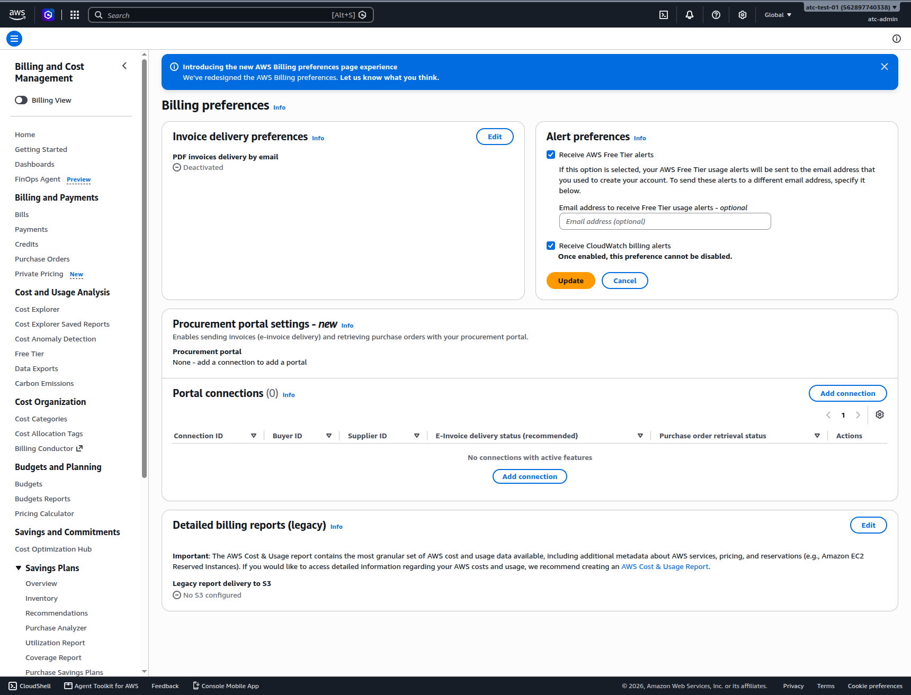
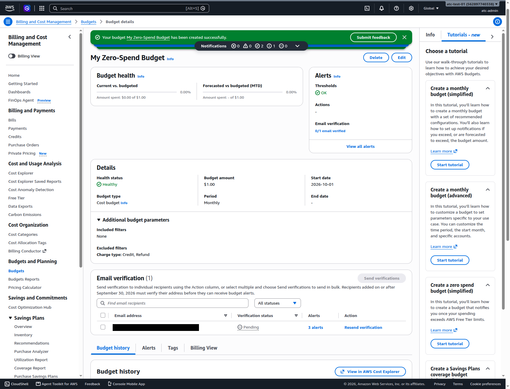
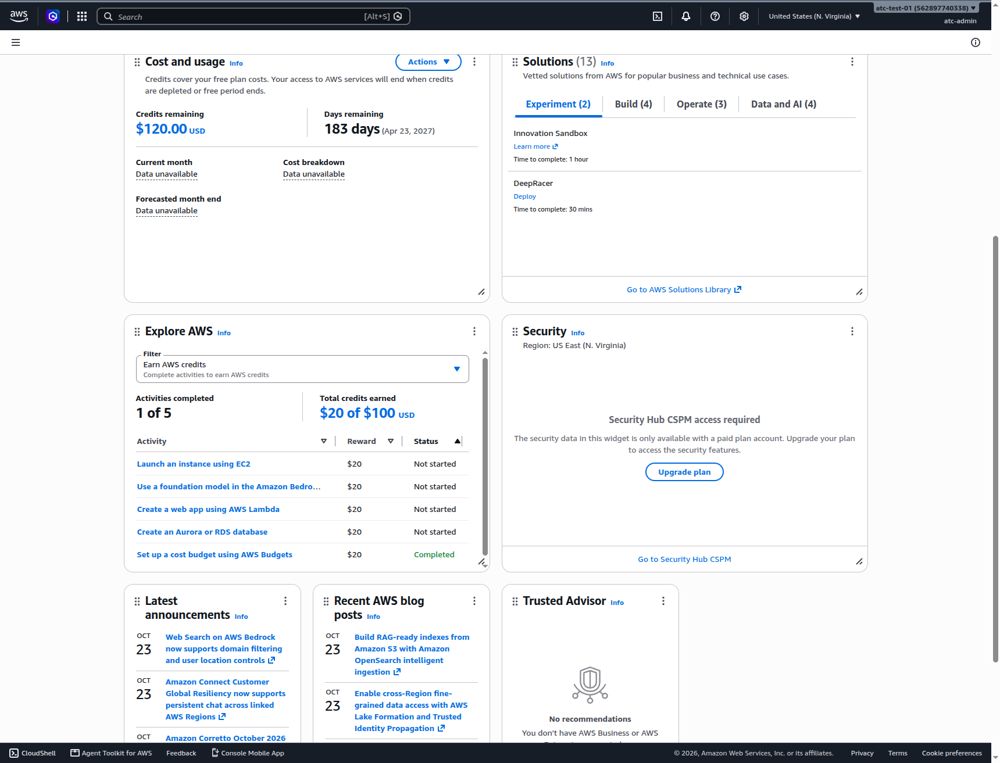

# Set up money alarms before you build anything

> **Your account, your responsibility.** Read the [notice](00-read-this-first.md#before-you-start-your-account-your-responsibility) before you follow any step.

Set up your cost alerts now, before your first lab creates anything. These alerts warn you. **They never stop spending.** AWS keeps running whatever you created until you delete it. On the Free plan, spending uses up your credits, and the plan ends early when they run out. On the Paid plan, it is real money on your card, and every alert here guards it. On the new sign-up experience, AWS's FAQ describes a monthly spend limit, but only on its Paid plan (as of 2026-10-23); we haven't confirmed billing alarms there.

**Goal:** five separate warnings point at an email address you read:

- Free Tier alerts and CloudWatch billing alerts are switched on.
- A zero-spend budget and a $5 monthly budget exist, and their alert email is verified.
- Cost anomaly alerts fire at $5 instead of the default $100.
- A billing alarm in us-east-1 sends email through a confirmed subscription.
- The date your Free plan ends is in your calendar.

**Before you start:**

- You activated IAM user and role access to billing information as root ([page 02](02-secure-the-root-user.md)). Without it, your IAM user can't open the billing pages.
- You are signed in as your IAM admin user with MFA ([page 03](03-your-everyday-admin-identity.md)).
- Have the inbox of an address you read every day open. AWS sends confirmation emails that can land in spam.
- Time: about 30 minutes, plus a check the next day. Cost: $0 (details in each section).

## Each alert watches something different

No single alert covers everything, so you set up several (figures checked 2026-10-23).

| Alert | What it watches | When it emails you | Its weak spot |
|---|---|---|---|
| Free Tier alerts | Use of each always-free offer | At 85% of a service's free limit | Covers only free allowances, not other spending |
| Zero-spend budget | Cost before credits and refunds | On the first spending over $0.01 | Billing data can be hours old |
| Monthly budget | This month's cost | At 85% and 100% of $5, and when the forecast passes $5 | Same delay |
| Cost anomaly detection | Spending that jumps above your normal pattern | A daily summary, once a jump reaches $5 | Needs about a day of cost data first |
| CloudWatch billing alarm | AWS's estimated charges for the month | When the estimate passes $1 | May stay at $0 while credits pay |

> **Bad practice: building anything before a budget exists.** Nothing in a new account tells you that money is moving. You find out from the bill, or when your credits are gone and the Free plan ends. Budgets also run hours behind, because AWS updates their billing data at least once a day ([Best practices for AWS Budgets](https://docs.aws.amazon.com/cost-management/latest/userguide/budgets-best-practices.html)), so an alert created after a mistake misses its first hours.

## Turn on the billing alert preferences

AWS's guide says Free Tier alerts start out on for standalone accounts. In our new account on 2026-10-23, both alert preferences showed **Not delivered**. Check yours.

1. In the console search bar, type `Billing` and open **Billing and Cost Management**.
2. In the left menu, choose **Billing preferences**. You may need to scroll the menu.
   **You should see:** a panel called **Alert preferences**, with **AWS Free Tier alerts** and **CloudWatch billing alerts** (as of 2026-10-23).
3. In **Alert preferences**, choose **Edit**.
4. Select **Receive AWS Free Tier alerts**. They go to your root user's email unless you add another address.
5. Select **Receive CloudWatch billing alerts**, which the billing alarm below needs. The screen warns that you can't turn it off again; that is harmless.
6. Choose **Update**.
   **You should see:** "Your alert preferences were updated successfully", and both alerts showing **Delivered** (as of 2026-10-23).

*Screenshot: Billing preferences, Alert preferences in edit mode with both alerts selected, captured 2026-10-23 in our test account. AWS console screenshots are AWS material used as limited fair use and are not covered by this primer's license.*

**Cost:** $0. **Free plan:** on the Free plan, only always-free offers are active, so these alerts cover those offers ([Tracking your AWS Free Tier usage](https://docs.aws.amazon.com/awsaccountbilling/latest/aboutv2/tracking-free-tier-usage.html)).

**Well-Architected:** Cost optimization · COST01-BP06 Monitor cost proactively

## Create a zero-spend budget and earn $20

A **budget** in AWS Budgets is a cost limit you set; AWS emails you as your cost nears or passes it. A **zero-spend budget** emails you as soon as anything costs money. Your first budget also completes a Free plan **Explore AWS** activity worth a $20 credit (as of 2026-10-23).

7. Open **Console Home** (choose the AWS logo at the top left). Find the **Explore AWS** panel and choose **Set up a cost budget using AWS Budgets**.
   **You should see:** a window showing a reward value of $20.00 USD and a "Complete by" date about six months away.
8. Choose **Start activity**.
   > **If something went wrong:** if it doesn't take you to Budgets, open **Billing and Cost Management**, choose **Budgets**, then **Create budget**.
9. Under **Budget setup**, keep **Use a template (simplified)** selected. Under **Templates**, choose **Zero spend budget**.
   **You should see:** the description "Create a budget that notifies you once your spending exceeds $0.01" (as of 2026-10-23).
10. Keep the name **My Zero-Spend Budget**. In **Email recipients**, type your email address.
11. Choose **Create budget**.
    **You should see:** a green message saying that the budget was created.

The new budget's page showed a budget amount of **$1.00** on 2026-10-23, although the template says it alerts on any spending over $0.01. Under **Additional budget parameters**, the excluded filters read "Charge type: Credit, Refund". So the budget counts cost *before* credits, and it should alert on the first cent even while credits pay. We haven't tested whether it really fires then.

*Screenshot: the zero-spend budget's details page, showing the $1.00 budget amount, the excluded credit and refund charges, and an email still pending verification, captured 2026-10-23 in our test account. AWS console screenshots are AWS material used as limited fair use and are not covered by this primer's license.*

## Verify the budget alert email

This step is new and easy to miss. An address added to a budget on or after 2026-09-30 must be verified before it gets alerts (as of 2026-10-23). Until then, the budget sends **nothing**, though everything looks fine.

12. On the budget's page, find **Email verification**. It shows your address with the status **Pending** (as of 2026-10-23).
13. Open the verification email from AWS and choose its link. Check spam; if it never arrives, choose **Resend verification**.
    **You should see:** after a refresh, the status **Verified** and "1/1 email verified". One verification covers every budget that uses the address.

## Create a $5 monthly budget

The zero-spend budget tells you that spending started. A monthly budget tells you when it adds up.

14. In **Budgets**, choose **Create budget**. Keep **Use a template (simplified)** and choose **Monthly cost budget**.
15. In **Enter your budgeted amount ($)**, replace the default `100` with `5`. A $100 default is far too high for a learning account.
16. In **Email recipients**, type the same verified address, then choose **Create budget**.
    **You should see:** both budgets in the **Budgets** list, $5.00 and $1.00, with health status **Healthy**.

This template emails you at 85% and 100% of $5, and when AWS forecasts that you will pass $5 (as of 2026-10-23). We haven't checked whether it counts cost before or after credits; its **Additional budget parameters** show what it excludes.

**Don't** expect a budget to act. These budgets only send email.

**Cost (checked 2026-10-23):** watching budgets and getting their alerts is free. Budgets with *actions*, which change your account automatically, cost $0.10 a day each after the first two, and budget reports cost $0.01 each. You need neither. One older AWS guide says only two budgets are free; follow the [AWS Budgets Pricing](https://aws.amazon.com/aws-cost-management/aws-budgets/pricing/) page.

**Free plan:** Budgets is always free on both plans. The $20 credit should appear on the **Credits** page within about a day; ours posted overnight, expiring 12 months after sign-up. The Free plan ends after 6 months, so that comes first.

**Well-Architected:** Cost optimization · COST01-BP03 Establish cloud budgets and forecasts; Cost optimization · COST01-BP05 Report and notify on cost optimization; Operational excellence · OPS08-BP04 Create actionable alerts

## Check Cost Explorer and lower the anomaly alert

**Cost Explorer** shows charts of what you spent. **Cost Anomaly Detection** compares spending with what it expected and emails you when spending jumps. In our account, creating budgets switched both on, and a "Getting started with AWS Cost Anomaly Detection" email arrived.

17. In **Billing and Cost Management**, choose **Cost Explorer**.
    **You should see:** on the first visit, a message that your data is being prepared and to "check back in 24 hours" (as of 2026-10-23). Ours still had no data about 13 hours later, and Console Home's cost figures said "Data unavailable". That is normal for the first day.
18. In the left menu, choose **Cost Anomaly Detection**, then the **Cost monitors** tab.
    **You should see:** one monitor, **Default-Services-Monitor**, of type **AWS services**, **Managed by AWS**, watching all services.
19. Choose the **Alert subscriptions** tab, then **Default-Services-Subscription**. Choose the option to edit it.
    **You should see:** the default threshold, "$100.00 above the expected spend AND 40.00% above the expected spend" (as of 2026-10-23). Both must be true before AWS alerts you, and a $100 jump is far too large for a learner.
20. Change the dollar threshold from `100` to `5`. Choose **Remove** next to the percentage threshold, so only the $5 condition is left.
21. In **Alert recipients**, make sure an address you read is listed. Ours had one recipient already; we didn't record which address AWS filled in, so check it. Keep **Daily summaries**, then save.
    **You should see:** a summary line saying you will be alerted when the anomaly is $5.00 above the expected spend.

Treat anomaly alerts as a backstop: they depend on cost data that arrives a day late.

**Don't** switch on hourly data in Cost Explorer ($0.01 per 1,000 usage records a month), and don't call the Cost Explorer API from CloudShell ($0.01 per request) ([AWS Cost Explorer Pricing](https://aws.amazon.com/aws-cost-management/aws-cost-explorer/pricing/), checked 2026-10-23).

**Cost:** $0 in the console; AWS doesn't charge for Cost Anomaly Detection (checked 2026-10-23). **Free plan:** available on both plans.

**Well-Architected:** Cost optimization · COST01-BP06 Monitor cost proactively

## Create a billing alarm in us-east-1

**Amazon CloudWatch** is AWS's monitoring service. A CloudWatch **alarm** watches one number and acts when it crosses a line you set. AWS keeps the billing number, **EstimatedCharges**, only in US East (N. Virginia), and it covers all Regions. The alarm emails you through **Amazon SNS** (Simple Notification Service), which delivers messages to addresses subscribed to a **topic**.

This alarm works separately from Budgets, and you can prove its email path works. The caveat: it may stay at $0 while credits pay for your use. That claim comes from an AWS expert's answer on AWS re:Post, not AWS's own guide; we haven't been able to confirm it.

22. At the top right, set the Region selector to **United States (N. Virginia)**.
23. Open **CloudWatch** from the console search bar. In the left menu, choose **Alarms**, then **Create alarm**.
24. Choose **Select metric**. Choose **Billing**, then **Total Estimated Charge**. Select the row for **USD** and **EstimatedCharges**, then choose **Select metric**.
    > **If something went wrong:** if there is no **Billing** choice, check that the Region is N. Virginia and that you turned on CloudWatch billing alerts in step 5.
25. Under **Conditions**, keep **Static** and choose **Greater**. In the threshold box, type `1` (USD). Leave the statistic and period as they are (on 2026-10-23: Maximum, 6 hours). Choose **Next**.
26. Under **Notification**, keep **In alarm**. Choose **Create new topic**, and name it `billing-alarm-topic`. Type your email address, choose **Create topic**, then **Next**.
27. Name the alarm `billing-estimated-charges-over-1-usd`. Choose **Next**, check the summary, and create the alarm.
    **You should see:** a message that some subscriptions are pending confirmation. SNS sends nothing to an address until that address confirms.
28. In your inbox, open the email from AWS that asks you to confirm the subscription, and choose its confirmation link. Check spam.
29. Back in **CloudWatch**, **Alarms**, watch the alarm's **State**.
    **You should see:** **Insufficient data** at first, then **OK**. Ours changed to OK in 52 seconds on 2026-10-23.

**OK** means only "below the threshold". It doesn't prove that you will get an email; the confirmed subscription in step 28 does.

**Cost:** CloudWatch's always-free monthly allowance includes 10 alarms (checked 2026-10-23). **Free plan:** no effect. We haven't confirmed that billing alarms work the same on the new sign-up experience.

**Well-Architected:** Operational excellence · OPS08-BP04 Create actionable alerts

## Write down your credits and the plan's end date

Your Free plan ends after six months, or sooner if the credits run out. Then the account closes unless you choose to upgrade.

30. Open **Console Home** and find the **Cost and usage** panel.
    **You should see:** **Credits remaining** and **Days remaining**, with the end date in brackets after the days.
31. Put that end date in your calendar, with a reminder a few weeks before it. Use the date, not the day count. In our account, the counter showed "183 days" both on sign-up day and the next day.
32. Once a week, check **Credits remaining**, or the **Credits** page in **Billing and Cost Management**, which lists each credit and its expiry date.

*Screenshot: Console Home's Cost and usage panel the day after sign-up, with $120.00 in credits and the plan's end date beside the days remaining, captured 2026-10-24 in our test account. AWS console screenshots are AWS material used as limited fair use and are not covered by this primer's license.*

AWS says it also emails you when 50%, 25% and 10% of your credits remain, and 15, 7 and 2 days before the plan ends ([AWS Free Tier update](https://aws.amazon.com/blogs/aws/aws-free-tier-update-new-customers-can-get-started-and-explore-aws-with-up-to-200-in-credits/), July 2025). We haven't received these yet, so don't rely on them alone.

**Cost:** $0.

**Well-Architected:** Cost optimization · COST01-BP06 Monitor cost proactively

## Check your work

The next day, confirm, and then leave everything in place:

- **Billing preferences:** both alerts say **Delivered**.
- **Budgets:** $1.00 and $5.00, both **Healthy**, email "1/1 email verified".
- **Cost Anomaly Detection:** threshold $5.
- **CloudWatch (N. Virginia):** alarm **OK**, SNS subscription confirmed.
- **Credits:** the $20 budget credit is listed; the end date is in your calendar.

## Recap

You set up five warnings that watch spending in different ways, and confirmed each can reach you. None of them stops anything, so the habit that saves money is deleting what you create ([page 07](07-habits-for-every-lab.md)). Next, [page 06](06-safe-defaults.md) switches on free settings that block public access and encrypt storage.

## Check yourself

1. Your zero-spend budget says **Healthy** and your billing alarm says **OK**. Can you be sure the alerts will reach you?
   - A. Yes. Healthy and OK mean the alerts are working.
   - B. Not yet. Check that the budget email is verified and that you confirmed the SNS subscription.
   - C. No. Alerts only work after Cost Explorer has data.

   

Feedback

   **B is right.** Healthy and OK only mean spending is below the limit. A budget sends nothing to an unverified address, and SNS sends nothing until you confirm the subscription. **A** confuses "below the threshold" with "able to email you". **C** is wrong: Cost Explorer's data delay affects its charts and the anomaly alerts, not whether budgets and alarms can email you.

   

2. You forget a lab resource and leave it running, and your $5 budget emails you. What happens to the resource?
   - A. AWS stops it, because the budget has been passed.
   - B. Nothing. It keeps running and costing money until you delete it.
   - C. The Free plan blocks it once you pass $5.

   

Feedback

   **B is right.** Budgets and alarms only send messages. **A** is the common misunderstanding: these alerts never act on resources. **C** is wrong too: on the Free plan, the cost is taken from your credits, and the resource keeps running. If the credits run out, the plan ends and the account closes, which is worse.

   

3. Why should you put your Free plan's end date in a calendar instead of watching the "days remaining" number?

   

Feedback

   **Model answer:** the counter isn't reliable. In our account it showed the same number on two days in a row. The date shown beside it is a fixed point you can plan around. A reminder before that date gives you time to save work, delete resources, or decide to upgrade before the account closes.

   

## Where to check the current details

- [AWS Budgets Pricing](https://aws.amazon.com/aws-cost-management/aws-budgets/pricing/) (checked 2026-10-23)
- [Using a budget template (simplified)](https://docs.aws.amazon.com/cost-management/latest/userguide/budget-templates.html) (checked 2026-10-23)
- [Adding email recipients to a budget notification](https://docs.aws.amazon.com/cost-management/latest/userguide/budgets-email-recipients.html) (checked 2026-10-23)
- [Tracking your AWS Free Tier usage](https://docs.aws.amazon.com/awsaccountbilling/latest/aboutv2/tracking-free-tier-usage.html) (checked 2026-10-23)
- [Enabling Cost Explorer](https://docs.aws.amazon.com/cost-management/latest/userguide/ce-enable.html) (checked 2026-10-23)
- [Setting up your anomaly detection](https://docs.aws.amazon.com/cost-management/latest/userguide/settingup-ad.html) (checked 2026-10-23)
- [Create a billing alarm to monitor your estimated AWS charges](https://docs.aws.amazon.com/AmazonCloudWatch/latest/monitoring/monitor_estimated_charges_with_cloudwatch.html) (checked 2026-10-23)
- [Amazon CloudWatch Pricing](https://aws.amazon.com/cloudwatch/pricing/) (checked 2026-10-23)
- [AWS Free Tier](https://aws.amazon.com/free/) and [Free Tier FAQs](https://aws.amazon.com/free/free-tier-faqs/) (checked 2026-10-23)

---

"Set up money alarms before you build anything" by Automate the Cloud Inc., licensed under CC BY-NC 4.0 with the Additional Permission for Internal Training from Automate the Cloud Inc.
License: https://creativecommons.org/licenses/by-nc/4.0/
Permission: https://automatethe.cloud/licenses/atc-internal-training-permission.txt
