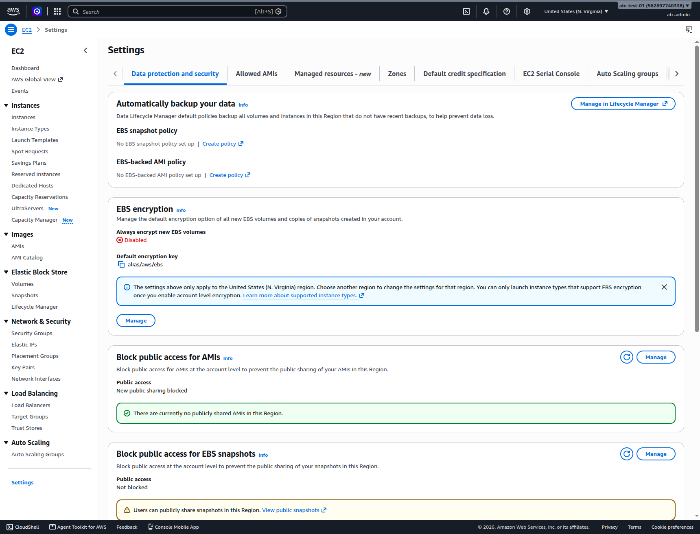
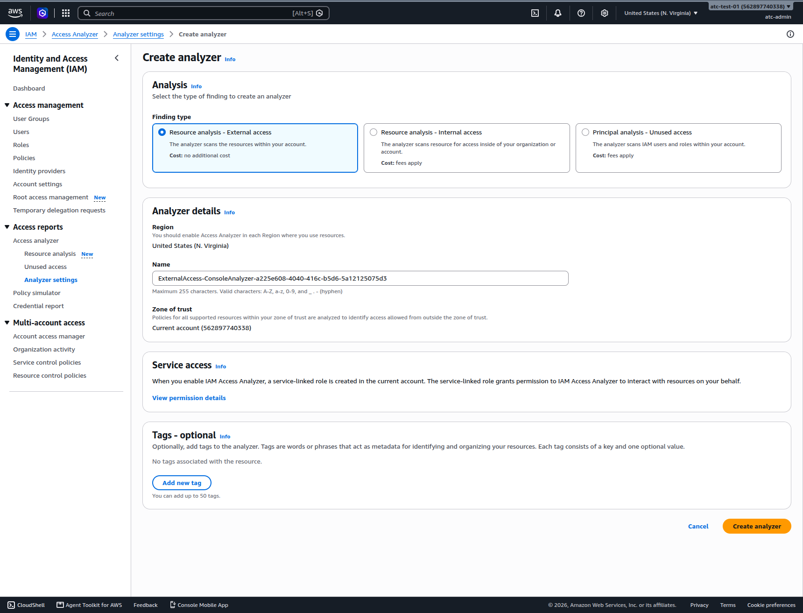
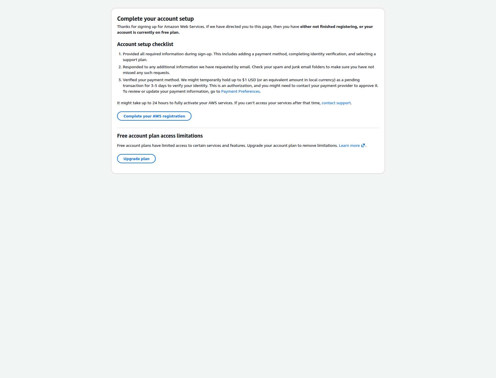

# Check your account's defaults and switch on the free protections

> **Your account, your responsibility.** Read the [notice](00-read-this-first.md#before-you-start-your-account-your-responsibility) before you follow any step.

A new AWS account does not start with every protection on. In the account we created on 2026-10-23, public access to stored files was not blocked at the account level, and new disks were not encrypted. On this page you check those defaults and switch on the protections that cost nothing. You finish one console before you open the next: S3, EC2, IAM, CloudTrail, Trusted Advisor, then your account's Region list.

**Goal and end state:**

- S3 blocks public access for the whole account.
- In US East (N. Virginia), new disks are encrypted, disk copies can't be shared publicly, and new servers default to the safer metadata service.
- One free analyzer reports anything in your account that is shared outside it.
- You know where to see what happened in your account, what Trusted Advisor checks for free, and which Regions are on.

**Time:** about 30–40 minutes. **Cost:** $0 (as of 2026-10-23). **Plan:** nothing here changes your Free plan, as long as you never choose **Upgrade plan** or **Upgrade**.

## Before you start

- **Sign in as your IAM admin user** ([Page 03](03-your-everyday-admin-identity.md)), not the root user. Finish [Page 02](02-secure-the-root-user.md) (root MFA), [Page 03](03-your-everyday-admin-identity.md) (admin user) and [Page 05](05-money-alarms.md) (budgets and billing alerts) first.
- **Check the Region.** A **Region** is one of AWS's geographic locations. Several settings here apply to one Region only. Our guides use **US East (N. Virginia), us-east-1**, unless a guide says otherwise. The Region name is near the top right of the console. Our new accounts opened in US East (Ohio), so check it now.
- **Expect screens to change.** Labels in bold are what we saw on 2026-10-23. AWS changes its consoles often; if a word differs, look for the same meaning.

## S3: block public access for the whole account

**Amazon S3** (Simple Storage Service) stores files in containers called *buckets*. Each new bucket blocks public access on its own. The account-level setting adds a second lock that a later bucket setting or policy can't undo. In our new account, all four account-level settings were **Off** (2026-10-23).

1. In the search bar at the top of the console, type `S3` and open **S3**.
2. In the left menu, choose **Account and organization settings**.
   **You should see:** **Block Public Access settings for this account**, with **Block *all* public access** and four settings, each **Off**.
3. Choose **Edit**, select **Block *all* public access**, and choose **Save changes**.
4. In the dialog, type `confirm` and choose **Confirm**.
   **You should see:** a green success message and **On** on all five lines.
   > **If something went wrong:** a red box lower on the page, **AWS Organizations administrator permissions unavailable**, is normal. It belongs to another feature, and your account is not in an organization. Ignore it.

**Don't** turn this off, or make a bucket public, to get past an "Access Denied" error in a lab. Find the real cause instead, such as a missed step or a missing permission.

> **Bad practice: "a public S3 bucket to make it work."** A public bucket lets anyone on the internet read what is in it. A bucket made public "for a minute" is easy to forget, and its data stays exposed until you notice. This account-level setting exists to stop exactly that.

**Cost:** $0. **Free plan:** no change.

**Well-Architected:** Security · [SEC03-BP07 Analyze public and cross-account access](https://docs.aws.amazon.com/wellarchitected/latest/security-pillar/sec_permissions_analyze_cross_account.html)

## EC2: encrypt disks, block public sharing, require IMDSv2

**Amazon EC2** (Elastic Compute Cloud) runs virtual servers, called *instances*. Their disks are **EBS volumes** (Elastic Block Store). A copy of a disk is a *snapshot*; a saved server image is an **AMI** (Amazon Machine Image). Every setting in this section applies to one Region, so confirm the Region shows **United States (N. Virginia)**.

5. In the search bar, type `EC2` and open **EC2**. In the left menu, choose **Settings**, then the **Data protection and security** tab.
   **You should see:** what we saw on 2026-10-23 in us-east-1: **Always encrypt new EBS volumes: Disabled**; **Block public access for AMIs: New public sharing blocked**; **Block public access for EBS snapshots: Not blocked**; IMDS defaults at **No preference**.

   

   *Screenshot: EC2 data-protection defaults in us-east-1 on a new account, captured 2026-10-23 in our test account. AWS console screenshots are AWS material used as limited fair use and are not covered by this primer's license.*

   > **If something went wrong:** if the blue note names a Region other than N. Virginia, switch Regions and start this section again. Settings you changed in the other Region do no harm.

**Encrypt new disks.**

6. In the **EBS encryption** box, choose **Manage**.
7. Select **Enable**, leave the key as `alias/aws/ebs`, and choose **Update EBS encryption**.
   **You should see:** **Always encrypt new EBS volumes: Enabled**.

**Why:** every new disk is encrypted at rest, with no extra work in each lab. The page noted (2026-10-23) that you can then launch only instance types that support EBS encryption. **Cost:** the AWS managed key `aws/ebs` costs nothing to create or keep; each use of it is billed, at amounts too small to notice in labs (checked 2026-10-23).

**Well-Architected:** Security · [SEC08-BP02 Enforce encryption at rest](https://docs.aws.amazon.com/wellarchitected/latest/security-pillar/sec_protect_data_rest_encrypt.html)

**Block public sharing of snapshots and AMIs.**

8. In the **Block public access for EBS snapshots** box, choose **Manage**.
9. Select **Block public access**, choose **Block all public sharing**, and choose **Update**.
   **You should see:** **All sharing blocked**.
10. Check the **Block public access for AMIs** box still says **New public sharing blocked**. Leave it.

**Why:** a public snapshot or AMI lets anyone copy your disk and read it. **Cost:** AWS's pages state no price for the snapshot setting; we expect it is free but haven't been able to confirm (2026-10-23).

**Well-Architected:** Security · [SEC03-BP07 Analyze public and cross-account access](https://docs.aws.amazon.com/wellarchitected/latest/security-pillar/sec_permissions_analyze_cross_account.html)

**Make IMDSv2 the default.** The **instance metadata service (IMDS)** lets a running instance look up facts about itself. Version 2 (IMDSv2) requires a session token with each request, a protection version 1 lacks. Older guides launch instances that still allow version 1.

11. Scroll to the box about IMDS defaults and choose its **Manage** button.
    **You should see:** **Manage IMDS defaults**, with every field at **No preference**.
12. Set **Instance metadata service** to **Enabled** and **Metadata version** to **V2 only (token required)**. Leave the rest. Choose **Update**.
    **You should see:** a message that the instance metadata defaults were modified.

**Cost:** no price is stated; we expect it is free but haven't been able to confirm (2026-10-23).

**Well-Architected:** No single best practice covers IMDS. This step supports the security pillar's design principle "[Apply security at all layers](https://docs.aws.amazon.com/wellarchitected/latest/framework/sec-design.html)."

**A rule for every later lab: never open SSH or RDP to the world.** A **security group** is a firewall around an instance; by default it lets nothing in. To log in, a lab may have you open port 22 (SSH, for Linux) or 3389 (RDP, for Windows). Allow it only from your own computer's address (look for a source option such as **My IP**). Better, use a method that needs no open port, such as EC2 Instance Connect or Session Manager, when a lab offers one. Never set the source to `0.0.0.0/0`, which means "anywhere on the internet".

> **Bad practice: "SSH or RDP open to the world."** Anyone on the internet can then try to sign in to your instance, and automated tools scan for these ports constantly. Trusted Advisor flags this rule for that reason.

**Well-Architected:** Security · [SEC05-BP02 Control traffic flow within your network layers](https://docs.aws.amazon.com/wellarchitected/latest/security-pillar/sec_network_protection_layered.html); Security · [SEC06-BP03 Reduce manual management and interactive access](https://docs.aws.amazon.com/wellarchitected/latest/security-pillar/sec_protect_compute_reduce_manual_management.html)

## IAM: create one free analyzer, and leave Role manager off

**IAM Access Analyzer** reads the policies on your resources and reports anything reachable from outside your account. Create one *external access* analyzer, which is free. It works per Region, so stay in N. Virginia.

13. Open **IAM**. In the left menu, under **Access reports**, choose **Access analyzer**, then **Analyzer settings**.
14. Choose the button to create an analyzer (**Create analyzer** on 2026-10-23).
15. Under **Finding type**, choose **Resource analysis - External access**.
    **You should see:** **Cost: no additional cost** under it, and **Cost: fees apply** under the other two types.

    

    *Screenshot: IAM Access Analyzer finding types with their cost labels, captured 2026-10-23 in our test account. AWS console screenshots are AWS material used as limited fair use and are not covered by this primer's license.*

16. Leave the name and **Zone of trust** (**Current account**). Choose **Create analyzer**.
    **You should see:** a success message and **Findings (0)**. Findings can take a while to appear. IAM also creates a *service-linked role*, a role AWS manages so the analyzer can work. That is expected.
    > **If something went wrong:** if you created an **Internal access** or **Unused access** analyzer, delete it from **Analyzer settings** (select it and look for a delete action). Those are billed monthly, per role or user or per resource.

**Cost:** $0 for external access (labeled on screen, 2026-10-23). **Free plan:** available on both plans.

17. In the left menu, choose **Account settings** and find **Role manager**.
    **You should see:** it is disabled. Leave it off. On 2026-10-23 the page warned that its roles "are often highly permissive": they grant more access than a task needs.

**Well-Architected:** Security · [SEC03-BP07 Analyze public and cross-account access](https://docs.aws.amazon.com/wellarchitected/latest/security-pillar/sec_permissions_analyze_cross_account.html)

## CloudTrail: see what happened in your account

**AWS CloudTrail** records actions in your account. Its **Event history** is always on, free, and keeps 90 days of *management events*: actions on your account's settings and resources, such as creating a user.

18. Open **CloudTrail** and choose **Event history**.
    **You should see:** the changes you just made, such as turning on EBS encryption. In our account they appeared within minutes.
19. Under **Lookup attributes**, choose **User name** and type `root`.
    **You should see:** only the root user's actions. From now on this list should barely grow. Root activity you didn't do is a warning sign; [Page 08](08-when-something-goes-wrong.md) says what to do.
20. Choose **Clear filter**.

**Don't** create CloudTrail Lake or add *data events*; both cost money. A *trail* that saves logs to S3 is optional: its first copy of management events is free, but the storage uses your credits. **Cost:** $0.

**Well-Architected:** Security · [SEC04-BP01 Configure service and application logging](https://docs.aws.amazon.com/wellarchitected/latest/security-pillar/sec_detect_investigate_events_app_service_logging.html)

## Trusted Advisor: read the free checks

**AWS Trusted Advisor** checks your account against AWS's recommendations. The free Basic Support plan includes a small set of core checks. AWS's own pages disagree on how many checks exist, so we don't give a number.

21. Open **Trusted Advisor** and choose **Refresh all checks**.
22. In the left menu, choose **Security**.
    **You should see:** checks such as **Amazon S3 Bucket Permissions**, **MFA on Root Account**, **Security Groups - Specific Ports Unrestricted** and **Amazon EBS Public Snapshots**. Some may show no result until the refresh finishes.

**Don't** choose **Upgrade** in the box offering all checks: that buys a paid Support plan you don't need for study. Look here regularly while you run labs. **Cost:** $0.

**Well-Architected:** These fit only loosely; Trusted Advisor is a free way to review your account regularly. Security · [SEC01-BP08 Evaluate and implement new security services and features regularly](https://docs.aws.amazon.com/wellarchitected/latest/security-pillar/sec_securely_operate_implement_services_features.html); Cost optimization · [COST10-BP02 Review and analyze this workload regularly](https://docs.aws.amazon.com/wellarchitected/latest/cost-optimization-pillar/cost_evaluate_new_services_review_workload.html)

## Regions: keep the extra ones off and see what already exists

Older Regions are on in every account and can't be turned off. Newer *opt-in* Regions start off. Leave them off: something you start in a Region you never look at is easy to forget, and it keeps billing.

23. Choose your account name at the top right, then the option for your account page (on 2026-10-23 it opened as **Billing and Cost Management** › **Account**). Scroll to **AWS Regions**.
    **You should see:** opt-in Regions marked **Disabled**, the rest **Enabled by default**. Change nothing. Skip the banner inviting you to try the new account page; we haven't confirmed what it changes.

Turning a Region off does not stop charges: resources there keep billing until you delete them. Professionals also add an IAM policy that denies actions outside their Regions; that's optional, because a mistake can block global services such as IAM. **Cost:** $0.

**Well-Architected:** Cost optimization · [COST02-BP05 Implement cost controls](https://docs.aws.amazon.com/wellarchitected/latest/cost-optimization-pillar/cost_govern_usage_controls.html); Cost optimization · [COST07-BP02 Choose Regions based on cost](https://docs.aws.amazon.com/wellarchitected/latest/cost-optimization-pillar/cost_pricing_model_region_cost.html)

Every Region also has a **default VPC**: a ready-made network with public subnets and a route to the internet. Labs use it. Professionals often delete default VPCs they don't use; for now, leave them, and never launch anything in a Region you don't use.

24. Open **AWS Resource Explorer** and choose **Resources**.
    **You should see:** the default VPC's parts (subnets, an internet gateway, a security group, a network ACL, a route table) and things you made in earlier parts. On 2026-10-23 the first visit said setup had completed; refresh if results look partial.

**Well-Architected:** a loose fit. Security · [SEC05-BP01 Create network layers](https://docs.aws.amazon.com/wellarchitected/latest/security-pillar/sec_network_protection_create_layers.html)

## The paid security services stay off on the Free plan

Amazon GuardDuty, AWS Security Hub CSPM, Amazon Inspector, Amazon Macie and Amazon Detective watch for threats and weak settings. AWS's startup security baseline recommends GuardDuty and Security Hub, but AWS lists all five as Paid plan only (as of 2026-10-23). When we opened GuardDuty or Security Hub CSPM, we got a "Complete your account setup" page with "Free account plan access limitations" and an **Upgrade plan** button.

*Screenshot: opening GuardDuty on the Free plan, captured 2026-10-23 in our test account. AWS console screenshots are AWS material used as limited fair use and are not covered by this primer's license.*

**Don't** choose **Upgrade plan** unless a guide tells you to. Upgrading ends the Free plan for good, and AWS then bills anything your credits don't cover. **On the Paid plan:** these services offer 15- to 30-day trials that turn into billing without asking. Security Hub CSPM also uses AWS Config, which is billed. You turn each one off Region by Region. Put a trial's end date in your calendar before you start it.

**Well-Architected:** Security · [SEC04-BP01 Configure service and application logging](https://docs.aws.amazon.com/wellarchitected/latest/security-pillar/sec_detect_investigate_events_app_service_logging.html); Security · [SEC01-BP08 Evaluate and implement new security services and features regularly](https://docs.aws.amazon.com/wellarchitected/latest/security-pillar/sec_securely_operate_implement_services_features.html)

## If you signed up on the new sign-up path

That path fixes your Region, doesn't support Trusted Advisor, and offers only policy checks in IAM Access Analyzer. We haven't been able to confirm how the other settings here appear there.

## Check your work

- [ ] S3: **Block *all* public access** is **On**.
- [ ] EC2 in N. Virginia: EBS encryption **Enabled**; snapshots **All sharing blocked**; AMIs **New public sharing blocked**; metadata version **V2 only (token required)**.
- [ ] IAM: one external access analyzer and no other analyzer; **Role manager** off.
- [ ] CloudTrail Event history shows today's changes.
- [ ] No opt-in Region turned on, and no **Upgrade plan** or **Upgrade** chosen.

These settings stay on. Turn one off only when a guide tells you to, and turn it back on afterward.

## Recap

You closed the free gaps in a new account: public S3 access, unencrypted disks, public snapshots and IMDSv1. You added a free analyzer, found the free logs and checks, and kept unused Regions off. Two rules carry into every lab: no public bucket to make something work, and no SSH or RDP open to the world. Next, [Page 07](07-habits-for-every-lab.md) covers habits for every lab.

## Check yourself

**1.** For one lab you switch to US West (Oregon) and create a disk there. Is it encrypted by default?

Feedback

No, unless you turned on EBS encryption in Oregon too. The EC2 settings and Access Analyzer work per Region, and you set them in N. Virginia only. Repeat them in any Region before you work there. The S3 account-level setting is different: it covers the whole account.

**2.** A lab's file won't load from your bucket, and a forum post says to switch off Block Public Access. What do you do?

- A. Switch off the account-level setting for a few minutes.
- B. Leave it on, and look for a missed step or a missing permission.
- C. Make only that one bucket public.

Feedback

**B** is right: you can fix the real cause without exposing data. **A** exposes every bucket in the account, and "a few minutes" is easy to forget. **C** exposes less, but it is still a public bucket "to make it work", the bad practice this page names.

**3.** You open GuardDuty and see an **Upgrade plan** button. What does it tell you, and what do you do?

Feedback

It tells you GuardDuty is a Paid plan service and your account is on the Free plan. Nothing is wrong. Close the page and choose nothing: upgrading ends the Free plan for good, and Paid plan trials turn into billing without asking.

## Where to check the current details

All checked 2026-10-23.

- [Blocking public access to your Amazon S3 storage](https://docs.aws.amazon.com/AmazonS3/latest/userguide/access-control-block-public-access.html)
- [Enable Amazon EBS encryption by default](https://docs.aws.amazon.com/ebs/latest/userguide/encryption-by-default.html)
- [AWS Key Management Service pricing](https://aws.amazon.com/kms/pricing/)
- [Block public access for Amazon EBS snapshots](https://docs.aws.amazon.com/ebs/latest/userguide/block-public-access-snapshots.html)
- [Configure instance metadata options for new instances](https://docs.aws.amazon.com/AWSEC2/latest/UserGuide/configuring-IMDS-new-instances.html)
- [Security group rules for different use cases](https://docs.aws.amazon.com/AWSEC2/latest/UserGuide/security-group-rules-reference.html)
- [IAM Access Analyzer pricing](https://aws.amazon.com/iam/access-analyzer/pricing/)
- [AWS CloudTrail pricing](https://aws.amazon.com/cloudtrail/pricing/)
- [AWS Support plan comparison](https://aws.amazon.com/premiumsupport/plans/)
- [Enable or disable AWS Regions in your account](https://docs.aws.amazon.com/accounts/latest/reference/manage-acct-regions.html)
- [Default VPCs](https://docs.aws.amazon.com/vpc/latest/userguide/default-vpc.html)
- [AWS Free Tier](https://aws.amazon.com/free/), for which services each plan includes

---

"Check your account's defaults and switch on the free protections" by Automate the Cloud Inc., licensed under CC BY-NC 4.0 with the Additional Permission for Internal Training from Automate the Cloud Inc.
License: https://creativecommons.org/licenses/by-nc/4.0/
Permission: https://automatethe.cloud/licenses/atc-internal-training-permission.txt
